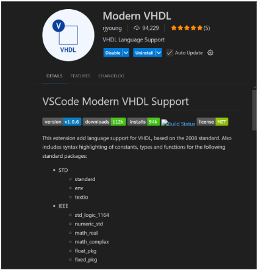
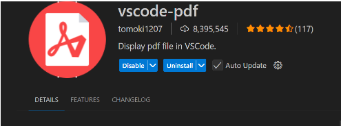
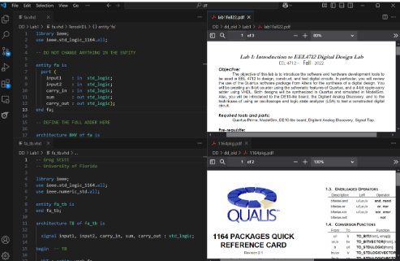

# Best Practices and Recommendations

This section summarizes the recommended workflow and setup for working with **QuestaSim** and **Quartus**.

## File Structure

Quartus and Questa may not function correctly if the file path contains spaces or special characters. To avoid problems, use only **letters, numbers, and underscores** in directory and file names.

A simple directory structure is recommended. For example:

```text
C:/Users/<name>/DigitalDesign/
├── Lab0/
│   ├── top_level.sv
│   ├── SimpleLogic.sv
│   ├── SimpleLogic_tb.sv
│   └── <Questa/Quartus-generated files and folders>
├── Lab1/
└── ...
```

Linux users should follow a similar structure.

> **Recommendation:** Create one main directory for the course and a separate subdirectory for each lab.

<!-- Insert image from the tutorial showing the recommended file structure here. -->

## Coding Environment

Although Questa and Quartus both include built-in editors, it is strongly recommended that you use an external development environment such as **Visual Studio Code (VS Code)** to write and edit your HDL code.

A modern editor can provide useful features such as:

- Syntax highlighting
- Basic syntax checking
- Code completion
- Linting and structural checks
- Easier management of multiple source and reference files

You can still use Questa for compilation and simulation and Quartus for synthesis and implementation.

## Recommended VS Code Extensions

### HDL language support

For Lab 0, use an editor extension that supports SystemVerilog. For VHDL projects, use a VHDL extension.

**Modern VHDL** is the primary recommended VS Code extension for VHDL development. It provides VHDL language support, syntax highlighting, basic syntax checking, and code-completion features.

<!-- Insert image from the tutorial showing the Modern VHDL extension here. -->


<p><strong style="color: #c62828;">Image needs updating for Lab 0. Show a VS Code extension with SystemVerilog support.</strong></p>

### vscode-pdf

The **vscode-pdf** extension allows PDF documents to be viewed directly inside VS Code. This can be useful for keeping lab instructions, reference sheets, and source code open within the same application.

<!-- Insert image from the tutorial showing the vscode-pdf extension here. -->


For example, VS Code can be arranged so that the VHDL design file, testbench, lab instructions, and VHDL reference material are all visible at the same time.

<!-- Insert image from the tutorial showing the example VS Code workspace here. -->


<p><strong style="color: #c62828;">Image needs updating for Lab 0. Show the SystemVerilog design and testbench alongside the current lab instructions.</strong></p>

## GitHub Copilot

The tutorial recommends disabling GitHub Copilot while completing course assignments. In particular, AI-generated HDL code can make it more difficult to develop the HDL design and debugging skills required for laboratory quizzes and exams.

To disable Copilot code completions in VS Code:

1. Click the **Copilot** icon in the lower-right corner of the VS Code window.
2. Disable **Code Completions (all files)**.

## Recommended Design Flow

For a typical lab assignment, use the following workflow:

1. **Save the provided lab files** in the appropriate lab directory.
2. **Write and edit your HDL code** in VS Code or another external editor.
3. **Compile in Questa first.** Questa provides a relatively fast way to identify most syntax and compilation problems.
4. **Run a functional simulation in Questa.** Verify that the design behaves as expected using the provided or developed testbench.
5. If the design does not behave correctly, **debug the design using the Questa simulation results**.
6. Once the design compiles and simulates correctly in Questa, **synthesize it in Quartus**.
7. Use Quartus to identify synthesis or implementation issues that may not be visible during functional simulation.
8. Once the design is correct, generate the required bitstream and test it as instructed.

A useful way to remember the workflow is:

```text
Write/Edit HDL
      ↓
Compile in Questa
      ↓
Functional Simulation
      ↓
Debug if necessary
      ↓
Synthesize/Implement in Quartus
      ↓
Program FPGA
      ↓
Demo
```

The key principle is to use **Questa for fast functional development and debugging** before running the more time-consuming Quartus synthesis and implementation flow.
