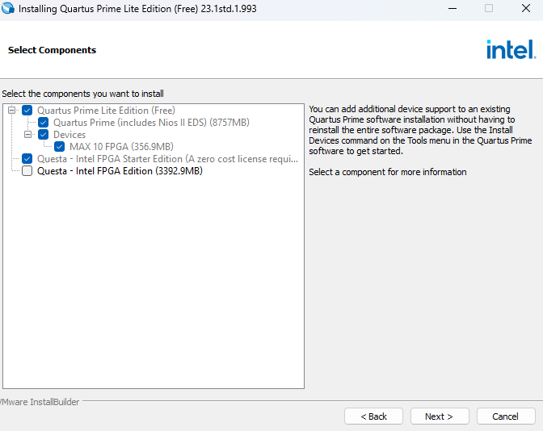
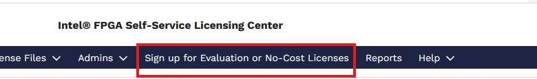
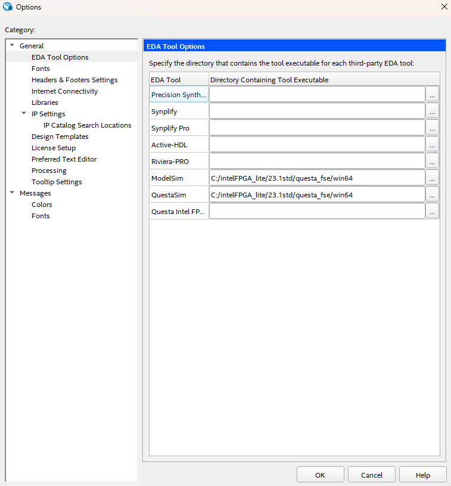

# Install Quartus and Questa on Windows

These steps use Quartus Prime Lite 23.1.1 and Questa FPGA Starter Edition. If both tools are already installed, check that Quartus includes MAX 10 support and that Questa opens with a valid license.

## Install the software

1. On the [Quartus Prime Lite 23.1.1 download page for Windows](https://www.altera.com/downloads/fpga-development-tools/quartus-prime-lite-edition-design-software-version-23-1-1-windows), open **Individual Files** and download **Quartus Prime**, **Questa FPGA and Starter Editions**, and **MAX 10 FPGA device support** into the same folder.
2. Run `QuartusLiteSetup-23.1std.1.993-windows.exe` and follow the setup wizard. Leave the default installation directory selected or record the directory you choose.
3. On the component selection screen, select **Quartus Prime Lite Edition (Free)**, **MAX 10 FPGA** under **Devices**, and **Questa FPGA Starter Edition**. Finish the installation.

## Request a free Questa license

1. Sign in to the [Altera FPGA Self-Service Licensing Center](https://www.altera.com/sslc) and choose the option to sign up for an evaluation or free license.
2. Select **Questa FPGA Starter Edition (SW-QUESTA)** and click **Next**.
3. Choose an existing computer if its network adapter ID still matches your machine. To add a computer, select **New Computer**, enter a name, set the license type to **FIXED**, and set the computer type to **NIC ID**.
4. In Windows Command Prompt, run `ipconfig /all`. Find the **Physical Address** for your physical Wi-Fi or Ethernet adapter and remove the hyphens. Enter those 12 hexadecimal characters as the **Primary Computer ID**.
5. Click **Generate License**. Save the emailed `.dat` attachment in a permanent folder, such as `C:\intelFPGA_lite\licenses`.

## Configure and verify the license

1. In Windows Start, search for **Edit the system environment variables**, then click **Environment Variables**.
2. Under **System variables**, add `LM_LICENSE_FILE` with the full path to the downloaded `.dat` file. If the variable already contains a license path, append the new path with a semicolon between entries.
3. Restart Windows, then launch **Questa FPGA Starter Edition** from the Start menu. If Questa reports a licensing error, confirm that the path points to the license file and that the license was issued for your adapter's physical address.
4. If `lmutil` is available, run `lmutil lmdiag` in Command Prompt to check which license is being used.

## Connect Quartus to Questa

1. Open Quartus and select **Tools → Options → EDA Tool Options**.
2. In the **QuestaSim** row, browse to the directory containing `vsim.exe`. For the installation shown here, that directory is `C:\intelFPGA_lite\23.1std\questa_fse\win64`.
3. Click **OK** to save the path. For Lab 0, launch Questa independently to run the SystemVerilog testbench.

Continue with [functional simulation in QuestaSim]() or the [Quartus and DE10-Lite tutorial]().

Adapted from the Spring 2026 *Quartus and QuestaSim Installation* handout.
