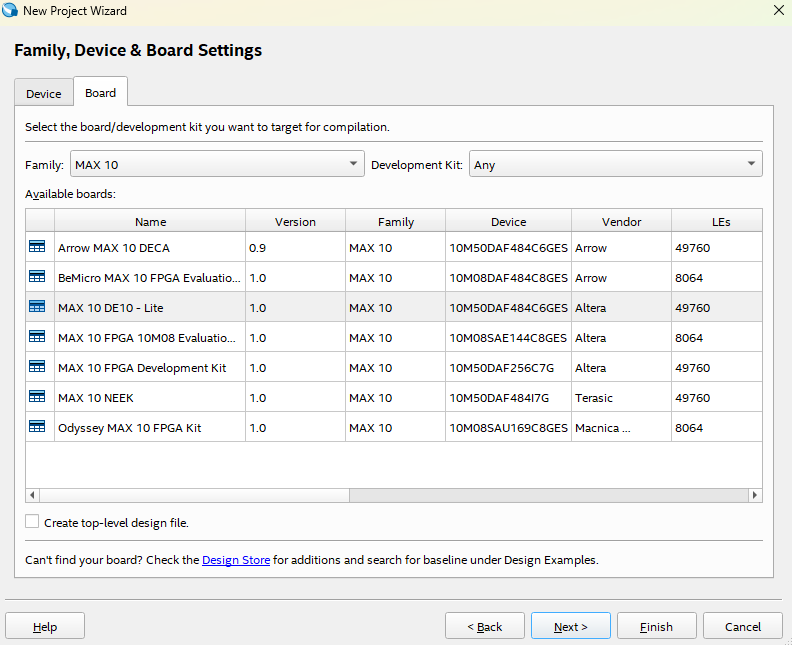
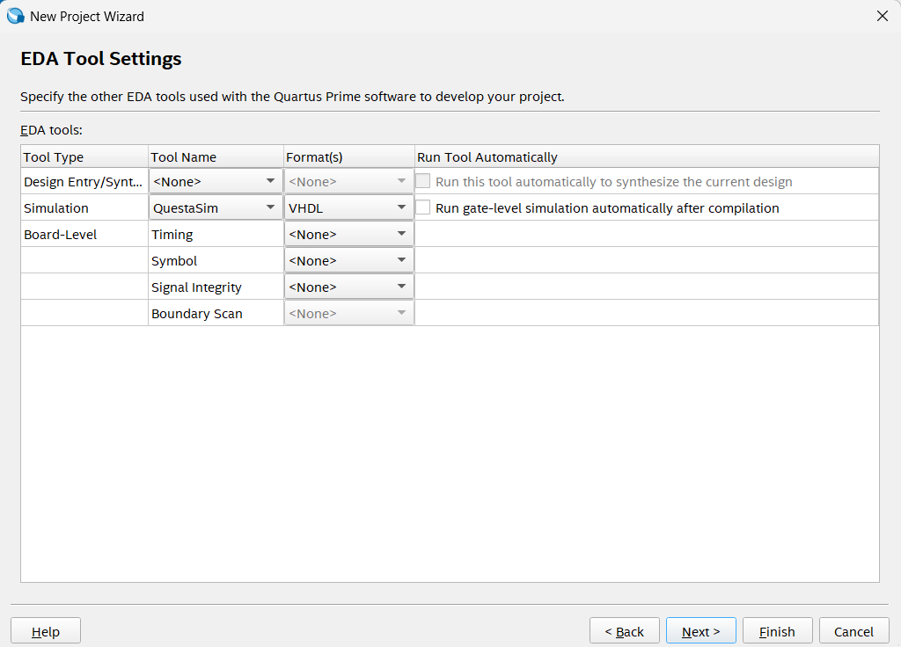
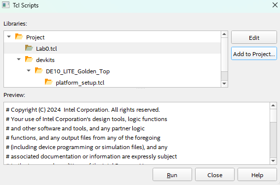
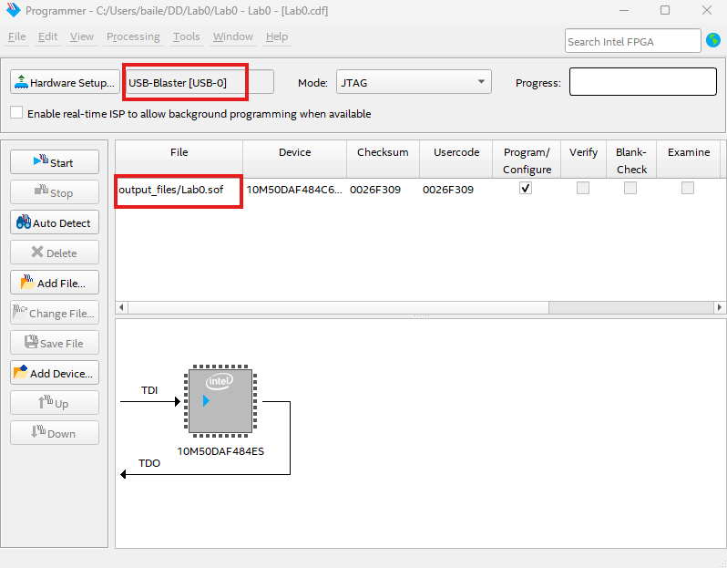

# Compile and Program the DE10-Lite with Quartus

In Lab 0, you will compile a SystemVerilog design, assign its signals to pins on the DE10-Lite, and load the compiled design onto the FPGA. Start with [Quartus Prime Lite and MAX 10 device support](). Use the [QuestaSim tutorial]() to verify the logic in simulation.

## Create the project

<mark style="background-color: #ff0; color: #000;"><strong>Do not use spaces anywhere in the full Quartus project path. This includes every parent folder and the project folder itself. Use only letters, numbers, and underscores in folder names.</strong></mark>

1. Save [SimpleLogic.sv]() and [top_level.sv]() in a lab folder such as `C:\Digital_Design\Lab0`.
2. Open Quartus Prime Lite and select **File → New Project Wizard**. Use the lab folder as the working directory, `Lab0` as the project name, and `top_level` as the top-level entity.
3. Select **Empty project**. On **Add Files**, add both SystemVerilog files. To add them later, use **Project → Add/Remove Files in Project**. If needed, right-click `top_level.sv` in the **Files** tab of the Project Navigator and choose **Set as Top-Level Entity**.
4. On **Family, Device & Board Settings**, open the **Board** tab, select **MAX 10 DE10 - Lite**, and clear **Create top-level design file**. The supplied wrapper connects the design to the board's switches and LEDs.

## Set up the EDA simulation tool

1. If Quartus does not know where QuestaSim is installed, [set the simulator executable directory](#connect-quartus-to-questa).
2. On the wizard’s **EDA Tool Settings** page, find the **Simulation** row. Select **QuestaSim** for **Tool Name** and **Verilog** for **Format(s)**. This setting controls the Quartus-generated simulation output. Keep your design and testbench files as `.sv`.
3. Leave **Run gate-level simulation automatically after compilation** unchecked. Click **Next**, review the summary, and click **Finish**. Run the Lab 0 functional simulation separately in QuestaSim.

For an existing project, open **Assignments → Settings → EDA Tool Settings → Simulation** to update the tool and format.

<strong style="color: #c62828;">Image needs updating for Lab 0. It shows VHDL in the Format(s) column. Select Verilog for this SystemVerilog lab.</strong>

## Compile the design

Select **Processing → Start Compilation**. Review **Compilation Report → Flow Summary** and the Messages pane. Resolve errors and investigate warnings about the top-level entity, pin assignments, or electrical settings before programming.

## Assign the board pins

Open **Assignments → Pin Planner** after the first compile. Enter the example assignment for SW0 below. **Node Name** is the port from `top_level.sv`, **Location** is the FPGA package pin, and **I/O Standard** is the electrical standard.

| Board signal | Node Name | Location | I/O Standard |
| --- | --- | --- | --- |
| SW0 | `sw[0]` | `PIN_C10` | 3.3-V LVTTL |
| SW1 | `sw[1]` | Look up in documentation | 3.3-V LVTTL |
| SW2 | `sw[2]` | Look up in documentation | 3.3-V LVTTL |
| SW3 | `sw[3]` | Look up in documentation | 3.3-V LVTTL |
| LEDR0 | `leds[0]` | Look up in documentation | 3.3-V LVTTL |

Look up the missing **Location** values in the copy of the [Terasic DE10-Lite User Manual](https://github.com/EEL4712-Digital-Design/lab0-main/blob/main/DE10-Lite_User_Manual.pdf) included with Lab 0. Use Table 3-4 on printed page 26 for the switches and Table 3-5 on printed page 27 for the LED. Enter each FPGA pin in the **Location** field for its corresponding node.

### Reuse pin assignments in another lab

1. In **Pin Planner**, select **File → Export** and save the assignments as `pin_assignments.tcl` in a folder shared by your lab projects.
2. In the new Quartus project, open **Tools → Tcl Scripts → Add to Project** and select the saved script.
3. Select the script and click **Run**. Open **Pin Planner** to verify that the imported assignments match the active top-level ports. A name mismatch can leave a port without its intended pin.

## Program the DE10-Lite

1. Go to **Assignments → Device → Device and Pin Options → Unused Pins** and select **As input tri-stated**. After checking the pin assignments, run **Processing → Start Compilation** again so the programming file includes the final assignments and settings.
2. Power the DE10-Lite and connect its USB-Blaster port to your computer. Open **Tools → Programmer** in Quartus.
3. Click **Hardware Setup**, select **USB-Blaster [USB-x]**, and use **JTAG** mode. If USB-Blaster is missing, check the USB connection and install the driver from the Quartus installation directory. [Altera USB-Blaster driver instructions](https://docs.altera.com/r/docs/683076/current/altera-fpga-download-cable-user-guide/installing-the-altera-fpga-download-cable-driver-on-windows)
4. Use `output_files/Lab0.sof` for volatile JTAG programming. If the file is missing from the list, click **Add File** and select it. Check **Program/Configure**, click **Start**, and wait for progress to reach **100%**. A `.pof` targets nonvolatile configuration memory and can replace the factory design.
5. Test the design using the [expected values from the QuestaSim tutorial](#understanding-the-testbench). Start with SW0–SW3 down, then raise SW0, SW1, SW2, and SW3 in order, leaving each switch up. LEDR0 should be on, off, on, off, then on.

