# QuestaSim Installation

This guide describes how to install and configure **Siemens QuestaSim 2026.2** for EEL5721 Reconfigurable Computing.

QuestaSim is used to compile and simulate VHDL designs throughout the course.

## Installation

1. Create an account with your `@ufl.edu` address on the official Siemens website: [https://customer.sw.siemens.com/en-US](https://customer.sw.siemens.com/en-US){:target="_blank" rel="noopener noreferrer"}
   > **IMPORTANT**: Use only ufl.edu mail address (e.g., abcd@ufl.edu). Any other email address would not work as this link is accessible to only current UF students who are taking this class.

1. Scroll down for a bit to see the **“Register for Support Center”** button.

   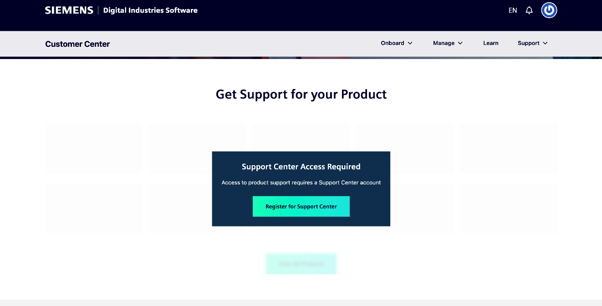

1. Once you click on it, you will be redirected to the Support center registration portal.

   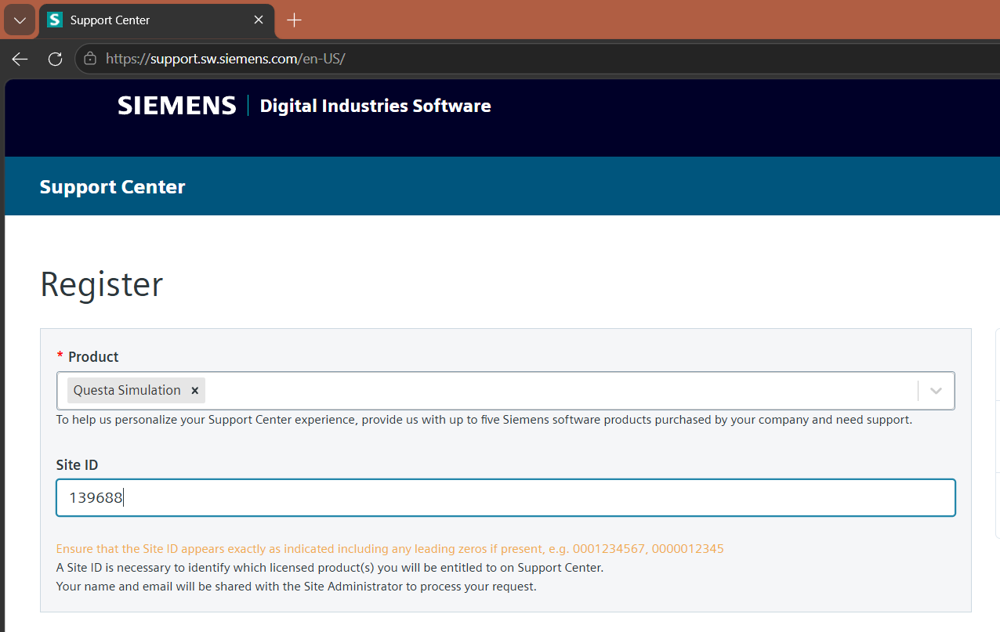

1. Fill in all the details (Company Name: University of Florida, Occupation: Student) on that page and click on “**REGISTER”.** You will see the message below. Wait for approval from the Support Center. Dr. Bobda is the Site Administrator, and we have to wait for his approval to be granted access to the Download files. This is why, it is important that you register with your “**ufl.edu”** mail address.

   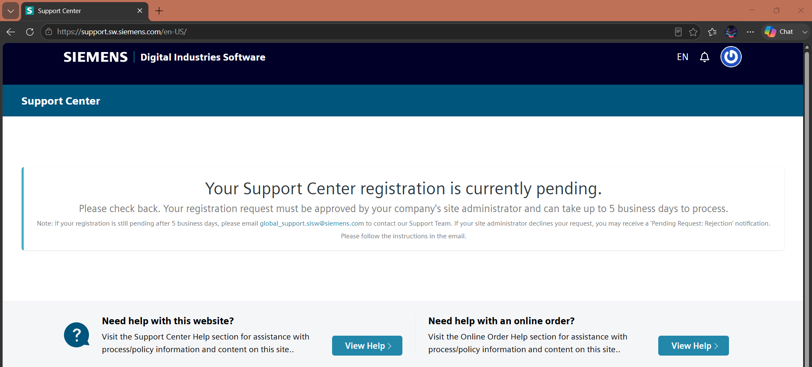

1. Once you receive the approval mail, navigate to the link in the mail for downloading QuestaSim: [https://support.sw.siemens.com/en-US/](https://support.sw.siemens.com/en-US/){:target="_blank" rel="noopener noreferrer"}

   > **Note**: If you are not able to see any download files, in the same approval email, you will find the global support mail to mail to incase of any concerns: [global_support.sisw@siemens.com](mailto:global_support.sisw@siemens.com) You will have to raise a support ticket and usually, they are prompt with their responses.

1. Click on Questa Simulation

   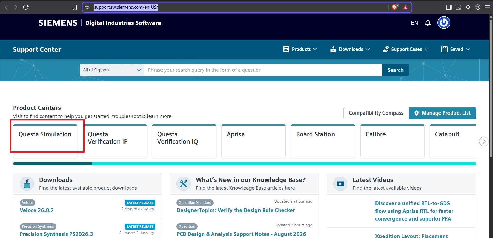

1. Click on the Latest Release to Download it.

   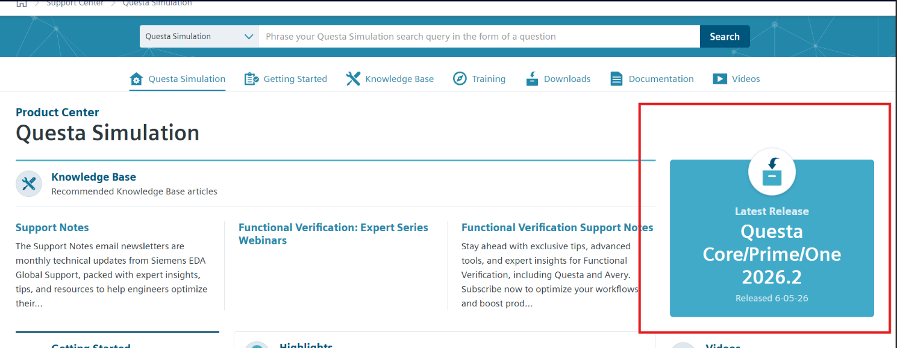

1. Scroll down for a bit to find our release file. This is the version of QuestaSim that we want to install. Depending on your OS, go for respective versions of installation. The one highlighted below is for Windows 64-bit.

   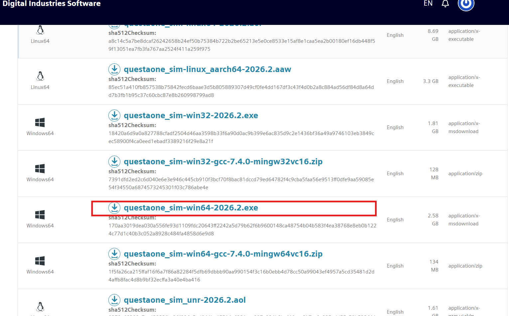

1. In the Downloads folder, double click on the executable. Once the installer file opens, click on “Next” and provide a desired target location in the “Source and Target” window. (Leave the default target location is fine.)

1. Agree to the License Agreement on the License Agreement page.

1. Wait for the products to be installed. Next, when prompted, click yes for both options.  
    **Desktop shortcut:** **Yes**, optional, but recommended for easy access. **Add Questa executable directory to PATH:** **Yes**, recommended so Questa commands can be launched from a terminal and found automatically by scripts/tools.

    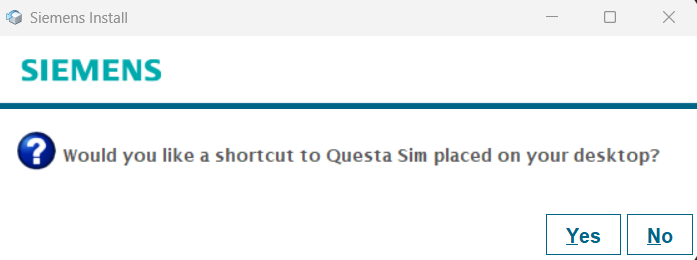

    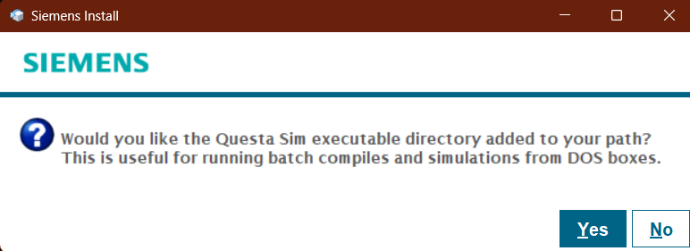

## Licensing

EEL5721 uses a **floating Siemens Questa license provided by the University
of Florida**. You do **not** need to obtain an individual license or generate
a license file.

On Windows:

1. Search for **Edit the system environment variables** from the Start menu.
1. Click **Environment Variables**.
1. Under **System Variables**, click **New**.
1. Enter the following:

   **Variable name:**
   ```
   SALT_LICENSE_SERVER
   ```

   **Variable value:**
   ```
   1717@ece-itop-licsvr.ece.ufl.edu
   ```

   The configuration should look like this:

   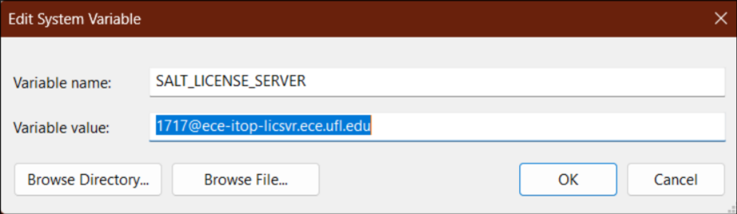

1. Click **OK** to save the variable and close the remaining environment-variable windows.
1. **Restart your computer** for the changes to take effect.

### Connect to the GatorLink VPN

The floating Questa license is hosted on the UF network. When working
remotely, you must connect to the UF network before launching QuestaSim.

1. Open **Cisco Secure Client**.
1. Select **GatorLink VPN**.
1. Click **Connect** and authenticate using your GatorLink credentials.
1. You may have to approve the connection using the Duo authenticator app.

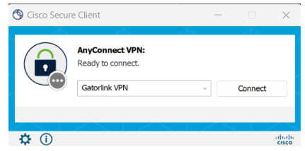

Remain connected to the GatorLink VPN while using QuestaSim.

### Verify the Installation

After connecting to the GatorLink VPN, launch QuestaSim. The application
should start without displaying a license error.

A successful launch should look similar to this:

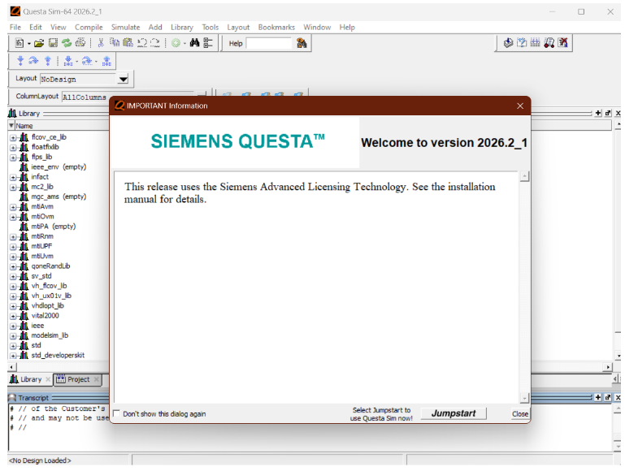

You can also verify that the command-line tools are available by opening a
terminal and running:

```bash
qrun -version
```

If `qrun` is not found, verify that the Questa executable directory was added
to your system `PATH` during installation.

## Troubleshooting

### License Error

If QuestaSim reports that it is unable to check out a license:

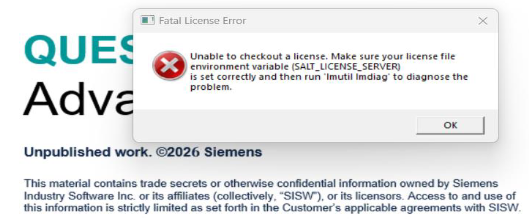

Verify that:

1. You are connected to the **GatorLink VPN**.
1. The `SALT_LICENSE_SERVER` environment variable is set to:
   ```
   1717@ece-itop-licsvr.ece.ufl.edu
   ```
1. You restarted your computer after adding the environment variable.

## Next Steps

After completing the installation, continue to the **QuestaSim Tutorial** for
instructions on compiling and simulating VHDL designs.
