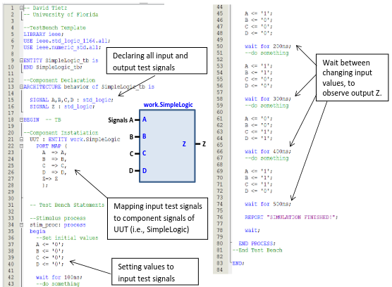
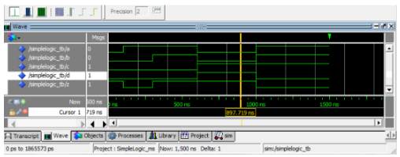

# Simulation Using QuestaSim

This guide summarizes the recommended workflow for creating a QuestaSim
project, adding VHDL design and testbench files, compiling the project,
and running a functional simulation.

## Creating a Project in QuestaSim

1.  Start **QuestaSim**.
2.  Select **File → New → Project**.
3.  Enter a project name, for example `SimpleLogic`.
4.  For **Project Location**, select the directory containing your
    lab/project files.
5.  Leave the remaining settings at their default values and click
    **OK**.

> **Important:** Avoid spaces and special characters in project paths
> and file names. Use letters, numbers, and underscores.


After creating the project, the **Add items to the Project** window will
appear.

### Add the Design File

Download [`SimpleLogic.vhd`]() and save it in your project directory.

1.  Click **Add Existing File**.
2.  Browse to `SimpleLogic.vhd`.
3.  Select the file and add it to the project.

You normally do not need to select **Copy to project directory**.

### Add the Testbench

Download [`SimpleLogic_tb.vhd`](), save it in your project directory, and add it in the same way:

1.  Click **Add Existing File**.
2.  Select `SimpleLogic_tb.vhd`.
3.  Click **OK**.
4.  Click **Close** when all required files have been added.

## Understanding the Testbench

A testbench is used to apply input test signals to the **Unit Under Test
(UUT)** and observe the resulting outputs.

A typical VHDL testbench must:

-   Declare the input and output test signals.
-   Instantiate the design being tested.
-   Map the testbench signals to the ports of the UUT.
-   Apply values to the input signals.
-   Wait between input changes so that the corresponding outputs can be
    observed.



For future designs, you may need to create or modify a testbench to
match the entity being tested. Make sure that the testbench signals are
mapped to the correct ports and that the stimulus exercises the required
behavior of the design.

## Compiling the Project

Before running a simulation, compile the VHDL files.

1.  Select **Compile → Compile All**.
2.  QuestaSim will compile the design file and testbench.

For the tutorial example, a successful compilation reports:

``` text
2 compiles, 0 failed with no errors.
```

The status of the compiled files should also change from `?` to a check
mark.

If compilation fails, inspect the error messages, correct the VHDL
source, and compile again before attempting to simulate the design.

## Running a Functional Simulation

A **functional simulation** verifies the logical behavior of the design.
Physical timing delays in FPGA components and interconnects are not
included.

### Start the Simulation

1.  Select **Simulate → Start Simulation...**
2.  In the **Design** tab, expand the `work` library.
3.  Select the **testbench**, for example:

    ``` text
    work → SimpleLogic_tb
    ```

    > Simulate the **testbench**, not the design entity directly.

4.  **BEFORE** clicking "OK", click **Optimization Options...**
5.  Select **Apply full visibility to all modules (full debug mode)**.
6.  Click **OK**, and then **OK** again to start the simulation.

### Display the Signals

The **Objects** and **Wave** windows are particularly useful during
simulation. If either is not visible, enable it from the **View** menu.

The Objects window contains the signals in the design. To inspect them
in the waveform:

1.  Select the desired signals in the **Objects** window.
2.  Drag them into the **Wave** window, or copy and paste them.

For the tutorial example, the signals are:

``` text
A
B
C
D
Z
```

### Run the Simulation

Select:

**Simulate → Run → Run -All**

The waveform window will display the input and output signals over
simulation time.




Use the waveform tools to:

-   Zoom in and out.
-   Scroll through simulation time.
-   Move the time cursor.
-   Compare input transitions with the expected output behavior.

## Recommended QuestaSim Workflow

For each lab, a useful workflow is:

``` text
Write/Edit VHDL
      ↓
Compile in QuestaSim
      ↓
Fix compilation errors
      ↓
Start the testbench simulation
      ↓
Add signals to the Wave window
      ↓
Run -All
      ↓
Inspect waveforms
      ↓
Debug and repeat as necessary
      ↓
Proceed to Vivado
```

QuestaSim should generally be your **first tool for compilation and
functional debugging**. Once the design compiles and simulates
correctly, proceed to Vivado for synthesis, implementation, and bitstream
generation.
