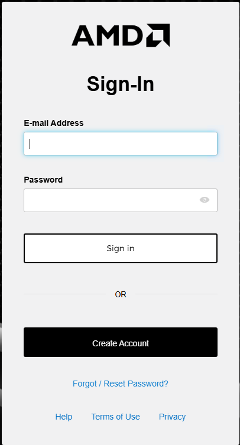
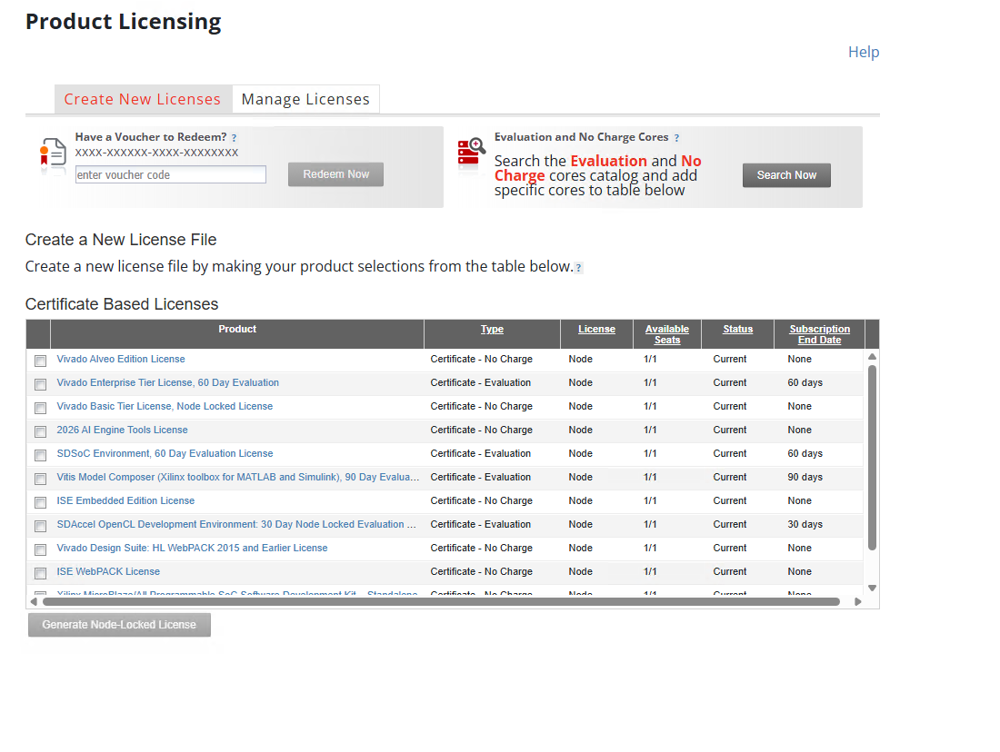
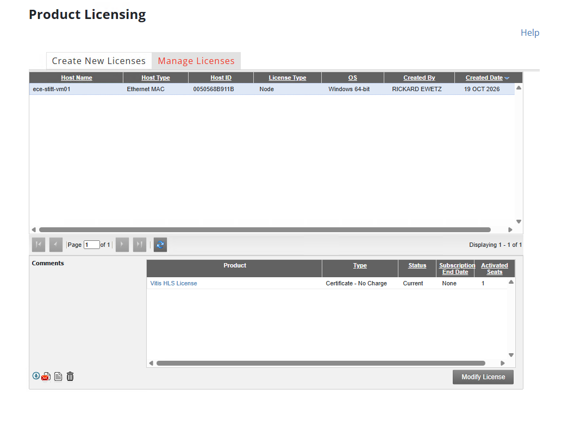
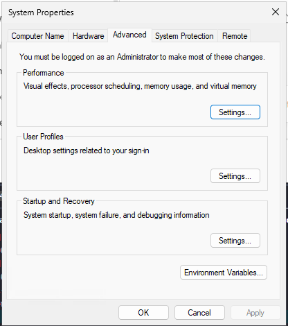
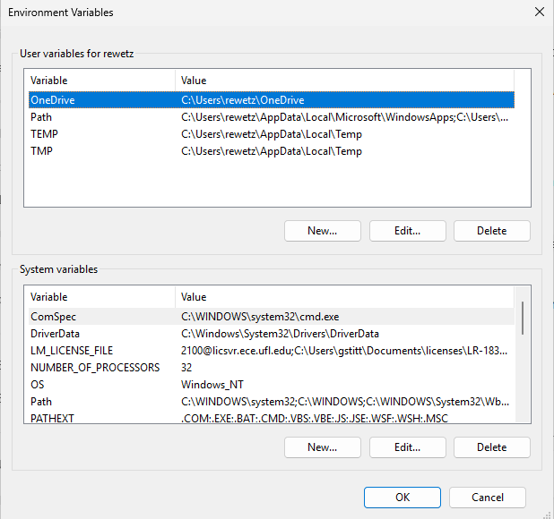
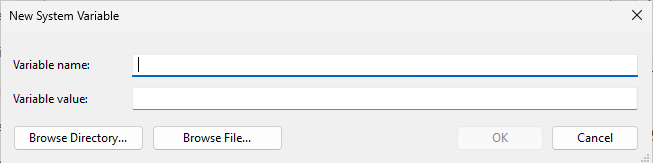

# Vitis HLS Installation and Setup

We will use **AMD Vitis Unified IDE (2025.2)** for the HLS labs. You can run Vitis on the **ECE server** or install and run it on your own computer.

## Option 1: Use the ECE server

Vitis is available on the ECE server, so you do not need to install it locally.

1. Log in to the ECE server and open a terminal in its graphical desktop environment. See the [remote access tutorial]() for how to access the server.
2. Start Vitis Unified IDE with:

   ```bash
   vitis_hls 
   ```

If the `vitis` command is not found, ask the course staff how to load the Vitis environment on the ECE server.

## Option 2: Use Vitis locally

The **Vitis tools** should have been installed at the same time that you installed Vivado using the AMD Unified Installer. You do not need to install it again.

On Windows, launch **Vitis Unified IDE** from the Start menu. You can also launch it from a Vitis-configured command prompt:

```bat
vitis 
```

If Vitis is not installed, rerun the [AMD Unified Installer](https://www.amd.com/en/support/downloads/adaptive-socs-and-fpgas/development-tools/2025-2.html) and select the Vitis tools. Installing Vivado alone does not guarantee that Vitis was selected.

### Obtain the free Vitis HLS license

The basic features of Vitis HLS work without a license. However, some HLS reporting features, including the **Dataflow Viewer** and **Code Analyzer**, require a free Vitis HLS license. Follow these steps to obtain and set up the license.

1. Go to the [AMD Product Licensing website](https://www.xilinx.com/getlicense).
2. Sign in with your AMD account (create one if needed).

   

3. Under **Create New Licenses**, select **Vitis HLS License**.

   

4. Choose **Generate Node-Locked License** for your personal computer.
5. Enter the requested host information and generate the license.

   

6. Download the license file sent to you by email.
7. Save the downloaded `.lic` file to a permanent location, for example `C:\XilinxLicenses\vitis_hls.lic`. Avoid keeping it in your Downloads folder, where it might be moved or deleted.

### Preferred: Configure the license with an environment variable (Windows)

1. Open **Windows Search**, type **Edit environment variables for your account**, and open it.

   

2. Under **User variables**, select **New** (or **Edit** if the variable already exists).

   

3. Enter the following values:

   - **Variable name:** `XILINXD_LICENSE_FILE`
   - **Variable value:** `C:\XilinxLicenses\vitis_hls.lic` (replace with the full path to your downloaded license file)

   

4. Click **OK** to save your changes and close the dialogs.
5. **Completely close and reopen Vitis Unified IDE** so it picks up the new environment variable. If you launch Vitis from a command prompt, open a new prompt first.
6. Optionally confirm the variable in a *new* Windows Command Prompt:

   ```bat
   echo %XILINXD_LICENSE_FILE%
   ```

   It should display the path to your `.lic` file.

Alternatively, set the same user environment variable from a Command Prompt:

```bat
setx XILINXD_LICENSE_FILE "C:\XilinxLicenses\vitis_hls.lic"
```

`setx` applies to **future** processes, not the currently open command prompt. Reopen Vitis afterward.

#### Backup license configuration method: Install the license using Vivado License Manager

If Vitis does not recognize the license after you set the environment variable:

1. Open **Vivado License Manager** (Windows Start menu: **Manage Licenses**, or run `vlm` from an AMD tools command prompt).
2. Use **Load License** to import the downloaded `.lic` file.
3. Restart Vitis and check whether the license-dependent features are available.


**Note:** The availability and expiration date of a no-charge or evaluation license depend on your AMD licensing entitlement. Follow the options shown in your account.

More information: [AMD Vitis HLS 2025.2 licensing instructions](https://docs.amd.com/r/2025.2-English/ug1399-vitis-hls/Obtaining-a-Vitis-HLS-License).
