# Vitis HLS Tutorial

## Overview

In this tutorial, you will convert a C++ vector addition function into RTL using Vitis Unified IDE 2025.2 or 2025.2.1. You will verify the C++ behavior, synthesize the hardware, inspect its schedule and interfaces, and verify the generated RTL using C/RTL co-simulation. You will then compare sequential execution, loop pipelining, loop unrolling, memory banking, and task-level dataflow.

Follow the steps below and use the accompanying screenshots to inspect the results. Keep the same FPGA part and clock settings for every experiment.

| Experiment | What you will investigate |
| --- | --- |
| Sequential vector addition | C simulation, synthesis, reports, and RTL verification |
| Pipelined vector addition | Overlapping successive loop iterations |
| Unrolling by four | Parallel operations and memory-port limits |
| Cyclic partitioning by four | Matching memory bandwidth to parallel computation |
| Load–compute–store dataflow | Overlapping separate tasks through FIFOs |

## 1 Create an HLS component

1. Open **Vitis Unified IDE** and choose **Set Workspace**, or select the workspace when prompted at launch. Use `C:\myHLSFiles\workspace`.
2. Choose **New HLS Component** on the welcome page, or **File → New Component → HLS**.

   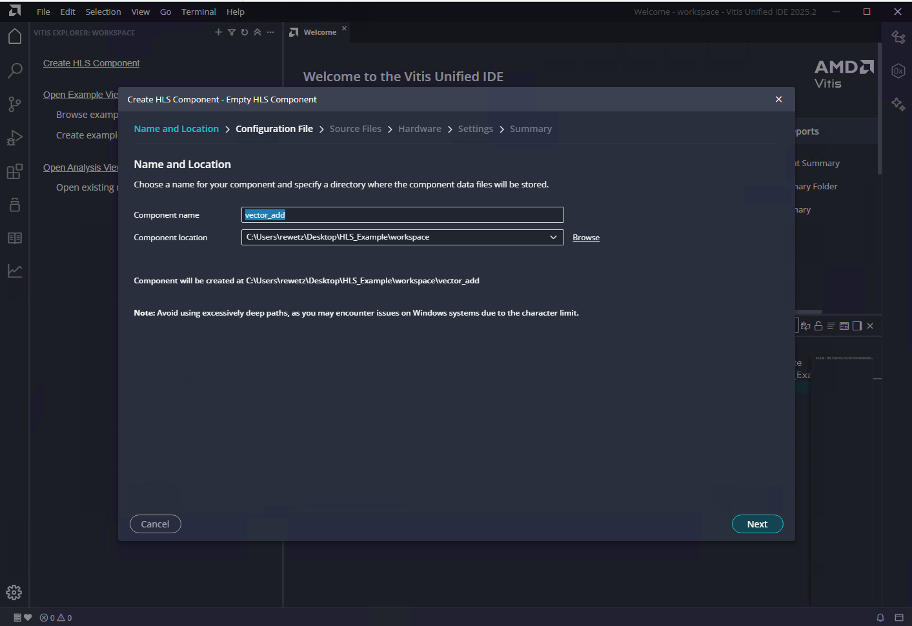
3. Name the component `vector_add` and use the workspace as its location.
4. Choose the configuration file to be **empty File** when prompted. A new file called **hls_config** will be created.
5. Browse to your local course GitHub repository and add `demo/vector_add.cpp` as a **design source**. Set the **top function** to `vector_add`; this is the C++ function name, not the filename or component name.
6. Add `demo/vector_add_tb.cpp` as a **testbench source**. Do not add it as a design source. Be careful to select to add a file and not a folder.

   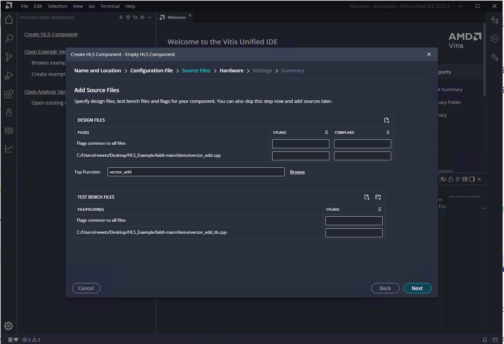
7. Select the FPGA part specified for your course board. Select xck26-sfvc784-2LV-c for the KV260.

   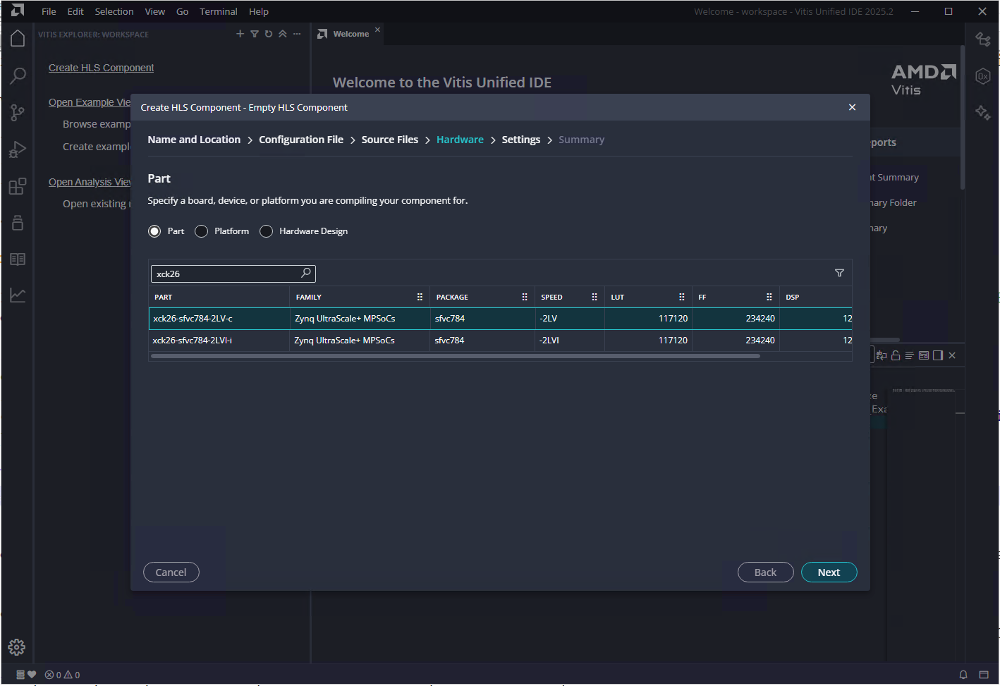
8. Select **vivado** as the flow target. Set the clock period to **10 ns** (100 MHz) and the clock margin to **10%**.

   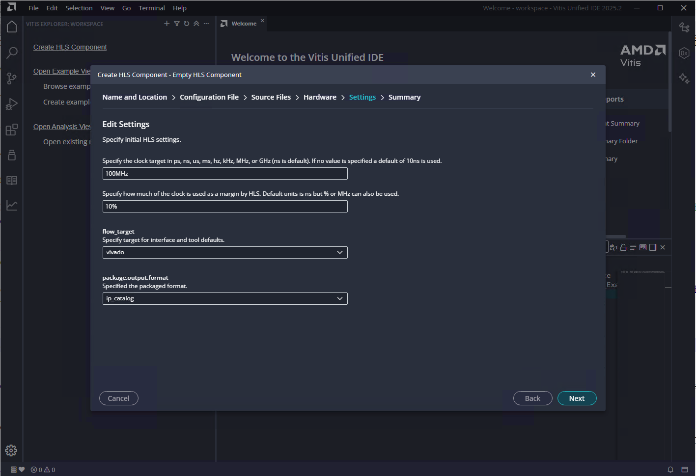
9. Review the summary and click **Finish**.
10. Select the component in the Components Explorer. Confirm that the Flow Navigator shows C Simulation, C Synthesis, and C/RTL Co-simulation.


11. Open the component configuration file and verify the top function, source files, part, flow target, and clock. Record the clock uncertainty if shown; use the same value throughout.

## 2 Run C simulation

1. Open `demo/vector_add.cpp`. Ensure the addition loop uses `PIPELINE off`, with loop unrolling and array partitioning disabled. Save the design and testbench files.
2. Select the `vector_add` component as the active component.
3. Under **C Simulation** in the Flow Navigator, click **Run**.
4. Wait for completion. Open the output console or simulation log.
5. Confirm that the testbench prints `PASS` and the simulation completes successfully.

   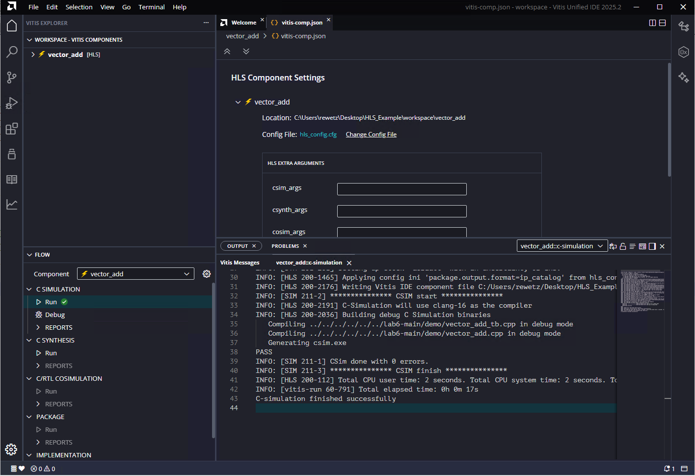

If simulation fails, read the first compilation error or output mismatch before proceeding. Do not synthesize a design whose C simulation fails.

## 3 Synthesize the sequential design

1. Under **C Synthesis**, click **Run**.
2. Wait until synthesis finishes successfully.
3. Expand the reports under C Synthesis and press **Synthesis**.
4. Find the top function and the `vector_add` loop in the latency/performance tables.
5. Record the top latency in cycles, loop latency, loop II if reported, estimated clock period, and BRAM, DSP, LUT, and FF estimates in the results table below.

   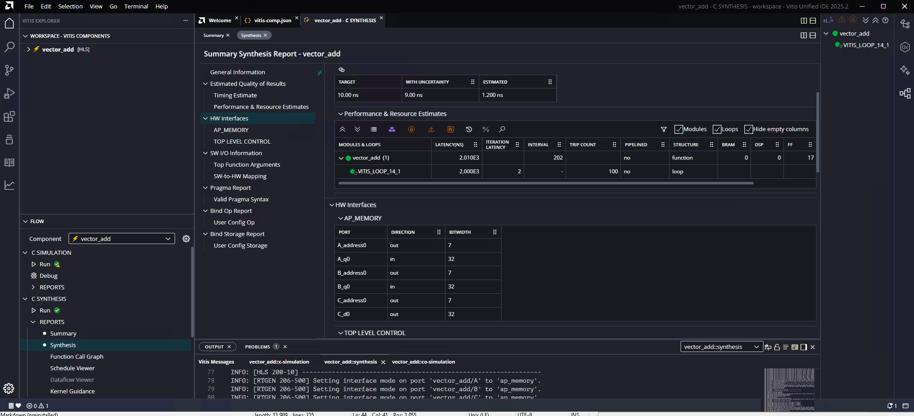
6. Read synthesis warnings. A successful run may still report an unmet timing or II target.

The main synthesis report and function-specific reports can overlap in content. Use the report containing the top-level summary for overall comparisons and the loop/module details to explain the result. A filename such as `vector_add_csynth.rpt` identifies the function-specific synthesis report; generated names can vary.

### Inspect the memory interfaces

Open the interface information or generated RTL. Locate the A, B, and C memory ports and their address, data, and enable signals as applicable.

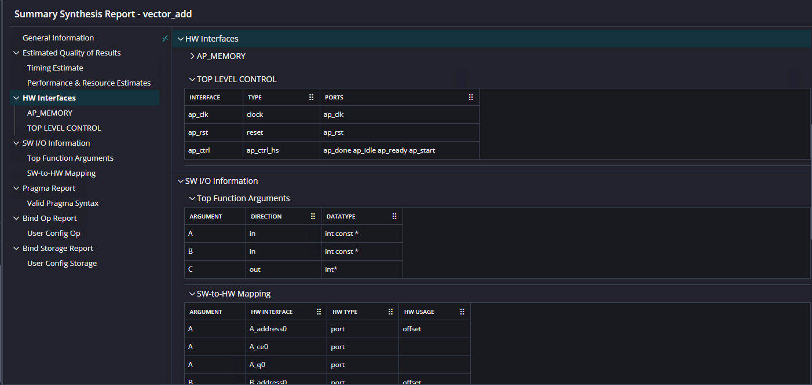

## 4 Inspect the Schedule Viewer

1. Press the **Schedule Viewer** under **C Synthesis** - **Reports**. It may also be accessible from the synthesis report navigation.
2. Inspect the VITIS_LOOP_14_1 loop.
3. Locate the reads from A and B, the addition, and the write to C.
4. Click an operation to cross-probe the source code and inspect its dependencies.

   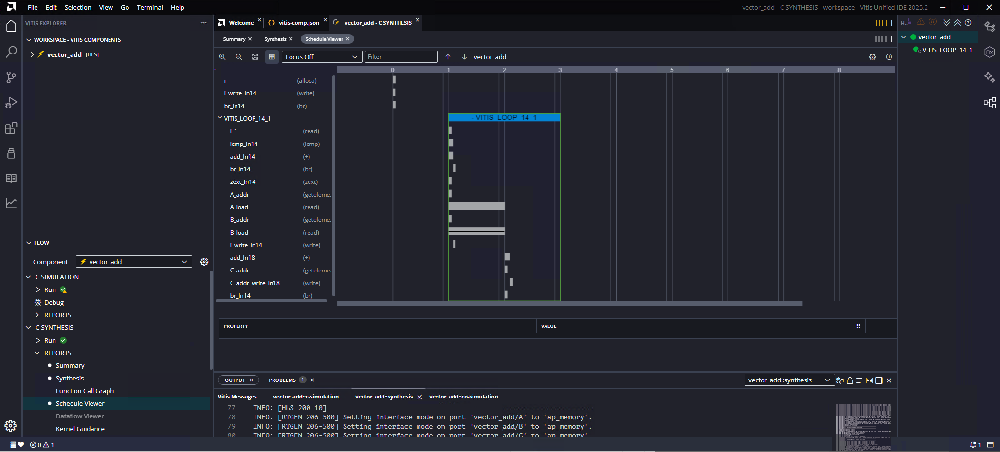

## 5 Run C and RTL co-simulation

1. Confirm that C simulation and C synthesis succeeded for the current source.
2. Under **C/RTL Co-simulation**, open the settings if needed.
3. Use the default settings and click **Run** and wait for completion.
4. Open the co-simulation report. Confirm a **PASS** result and record the reported latency and transaction interval when available.


## 6 Enable loop pipelining

1. Preserve the sequential results and screenshot before changing the source. You may copy reports outside the generated build directory, since later runs may overwrite them.
2. In `demo/vector_add.cpp`, comment out:

   ```cpp
   #pragma HLS PIPELINE off
   ```

   and uncomment:

   ```cpp
   #pragma HLS PIPELINE II=1
   ```

3. Save the file, rerun C simulation, and rerun C synthesis.
4. Record the **achieved** II of the `vector_add` loop, top latency, estimated clock period, and resource estimates.

   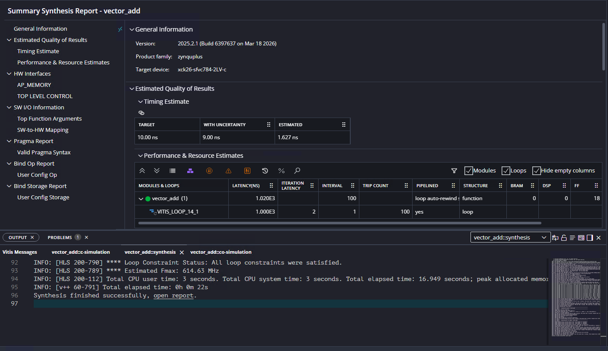
5. Open the Schedule Viewer and compare it with the sequential schedule.

   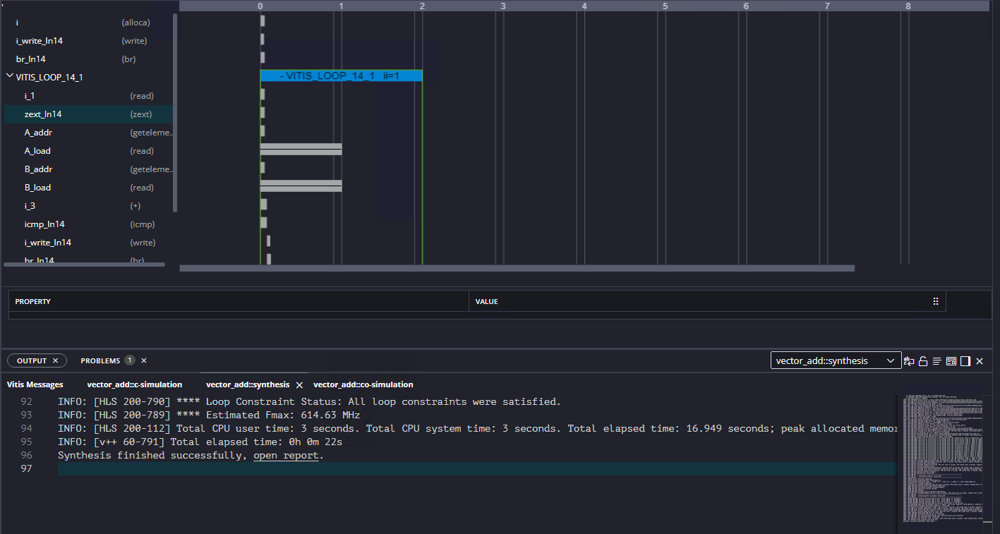
6. Rerun RTL co-simulation and confirm PASS.

## 7 Unroll by four without partitioning

1. Keep `PIPELINE II=1` in the loop.
2. Add the following pragma inside the same loop:

   ```cpp
   #pragma HLS UNROLL factor=4
   ```

3. Leave A, B, and C unpartitioned.
4. Save the file, rerun C simulation, and rerun C synthesis.
5. Record latency, achieved II, resources, and any messages about memory-port constraints or scheduling conflicts.
6. Inspect the schedule to identify whether four reads from each input and four writes to the output can be supported at once.


## 8 Add cyclic memory partitioning

1. Keep the loop pipeline and unroll pragmas from the previous experiment.
2. Immediately after the interface pragmas, before the loop, add:

   ```cpp
   #pragma HLS ARRAY_PARTITION variable=A cyclic factor=4 dim=1
   #pragma HLS ARRAY_PARTITION variable=B cyclic factor=4 dim=1
   #pragma HLS ARRAY_PARTITION variable=C cyclic factor=4 dim=1
   ```

3. Save the source and rerun C simulation and C synthesis.
4. Compare the achieved II, top latency, and resource estimates against the unrolled design without partitioning.
5. Inspect the interface report or generated RTL for the partitioned array ports.
6. Rerun RTL co-simulation and confirm PASS.

## 9 Create the dataflow example

The final experiment separates work into tasks. It demonstrates how FIFO-connected tasks overlap; it is a separate comparison from the four-lane unrolled design.

Use the supplied `demo/vector_dataflow.cpp` and `demo/vector_dataflow_tb.cpp` files.

1. Open and inspect `demo/vector_dataflow.cpp` and `demo/vector_dataflow_tb.cpp`. Locate the load, compute, and store helper functions, the stream declarations, and the top-level function.
2. Create a second HLS component named `vector_dataflow` using the same process as Section 1. **File->New Component->HLS**
3. Add `demo/vector_dataflow.cpp` as the design source, select `vector_dataflow` as the top function, and add `demo/vector_dataflow_tb.cpp` as the testbench source. Do not include the vector addition design or its testbench in this component.
4. Use the same part, vivado target, clock period, and uncertainty as before.
5. Run C simulation, C synthesis, and RTL co-simulation with DATAFLOW commented out.
6. Record latency and inspect the function hierarchy and schedule.

The FIFOs deliberately have depth 128, enough to hold the entire 100-element vector. Without task overlap, the load must finish before compute begins; a small FIFO could fill and block the producer indefinitely. C simulation uses stream behavior that does not establish that a finite RTL FIFO is large enough.

## 10 Enable and inspect dataflow

1. Uncomment `#pragma HLS DATAFLOW` in the top function. Keep FIFO depth 128 for the first comparison so that only one change is being evaluated.
2. Rerun C simulation and C synthesis. Record latency and resource estimates.
3. Under synthesis reports, open **Dataflow Viewer**. Inspect the load, compute, and store processes and the a, b, and c FIFO channels.

   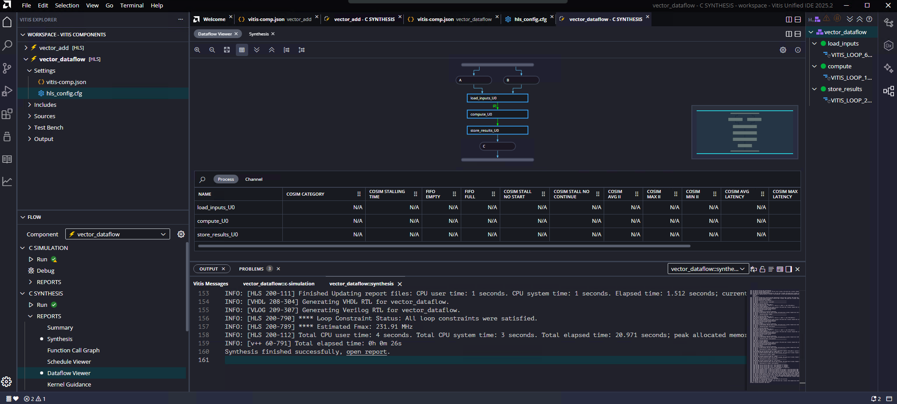
4. Open the HLS configuration file. Under its existing `[hls]` section, enable:

   ```ini
   cosim.enable_dataflow_profiling=true
   ```

   Alternatively, enable the corresponding dataflow profiling setting in the configuration editor.

5. Check that the supplied testbench calls the top function at least twice, as required for profiling. Run RTL co-simulation.
6. Reopen the Dataflow Viewer and inspect the channel occupancy and process blocking/stall information populated by co-simulation.

   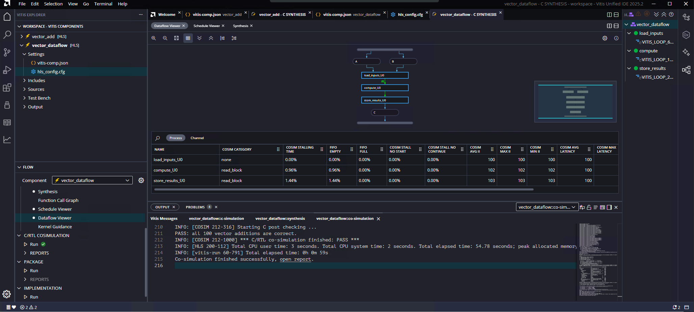
7. Compare the co-simulation latency with DATAFLOW disabled and enabled.

### Reduce FIFO depth

1. Keep DATAFLOW enabled and change all three stream depths from 128 to 4.
2. Rerun synthesis and profiled RTL co-simulation.
3. Confirm PASS and compare latency, resource estimates, maximum channel occupancy, and blocking behavior.
4. If simulation does not complete, stop the run and inspect the tool's deadlock diagnostics and channel state before increasing depths or changing the design.

Do not disable DATAFLOW again while retaining depth four in this example: the sequential load task cannot place 100 elements into a four-entry FIFO before compute starts.

## 11 Record and explain the results

Use a dash when a metric does not apply or is not reported. Record achieved values, not just requested values. Preserve baseline results before rerunning an experiment.

| Vector addition variant | Top latency cycles | Loop II | Elements per group | Estimated period ns | BRAM | DSP | LUT | FF | RTL PASS |
| --- | --- | --- | --- | --- | --- | --- | --- | --- | --- |
| Sequential | | | 1 | | | | | | |
| Pipeline II 1 | | | 1 | | | | | | |
| Pipeline and unroll 4 | | | 4 | | | | | | |
| Pipeline and unroll 4 and cyclic partition 4 | | | 4 | | | | | | |

| Task variant | Top latency cycles | Top transaction interval cycles | BRAM | DSP | LUT | FF | RTL PASS |
| --- | --- | --- | --- | --- | --- | --- | --- |
| DATAFLOW off and depth 128 | | | | | | | |
| DATAFLOW on and depth 128 | | | | | | | |
| DATAFLOW on and depth 4 | | | | | | | |

If the tool reports other storage resources, record those separately. Small FIFOs may use LUT-based memory or registers instead of BRAM.

At a 10 ns clock, `execution time = top latency × 10 ns`. Compute latency speedup as `baseline latency / optimized latency` using the same workload and constraints. These are estimates or simulation measurements under the modeled interfaces, not measured board performance.

Answer the following questions:

1. How do C simulation and RTL co-simulation differ?
2. Which operations occupy cycles in the sequential schedule?
3. What does an achieved II of 1 mean, and why does it differ from total latency?
4. Why can unrolling fail to provide the expected speedup?
5. Why does cyclic partitioning by four match four consecutive accesses? What would change for accesses separated by a stride of four?
6. Why can top-level arrays appear without internal BRAM usage?
7. Which tasks overlap when DATAFLOW is enabled, and what evidence shows that overlap?
8. Why does the sequential stream example need deep FIFOs, while the dataflow version can use shallower ones?
9. Which changes increase external memory interface requirements, and which add internal buffering?

## Reference documentation

The component workflow and viewer instructions follow AMD's Vitis 2025.2 documentation. The exact results depend on the selected part and tool configuration.

- [AMD Vitis getting started tutorial](https://docs.amd.com/r/2025.2-English/Vitis-Tutorials-Getting-Started/Using-the-New-Vitis-Unified-IDE?contentId=8x2J1bxGI54SLnPtmJ_OYg)
- [AMD Vitis HLS tutorial overview](https://docs.amd.com/r/2025.2-English/Vitis-Tutorials-Getting-Started/Vitis-HLS)
- [AMD C and RTL co-simulation](https://docs.amd.com/r/2025.2-English/ug1702-vitis-accelerated-reference/Running-C/RTL-Co-Simulation)
- [AMD Dataflow Viewer and profiling requirements](https://docs.amd.com/r/2025.2-English/ug1702-vitis-accelerated-reference/Dataflow-Viewer)
- [AMD automatic loop pipelining](https://docs.amd.com/r/2025.2-English/ug1399-vitis-hls/Automatic-Loop-Pipelining?contentId=Ps~qbS1lilkhJi9DQ9Wp6w)
