# Create and connect an AXI peripheral

This guide starts with a completed [base KV260 Vivado project]() and outlines how to package, connect, and build a simple AXI4-Lite peripheral.

## 1. Create the AXI peripheral

1. Open the base project's `design_1` block design.

    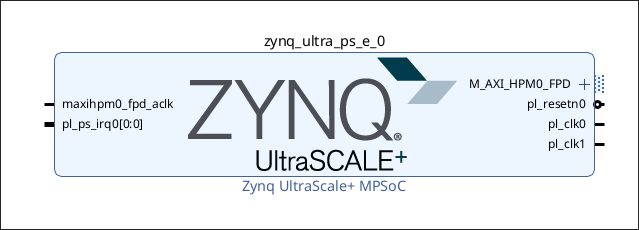

2. From the **Tools** menu, select **Create and Package New IP**, then select **Next** on the opening page.

    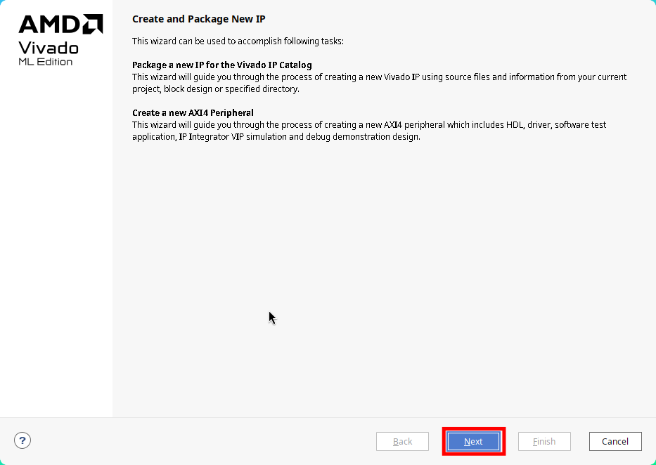

3. Select **Create a new AXI4 peripheral**, then select **Next**.

    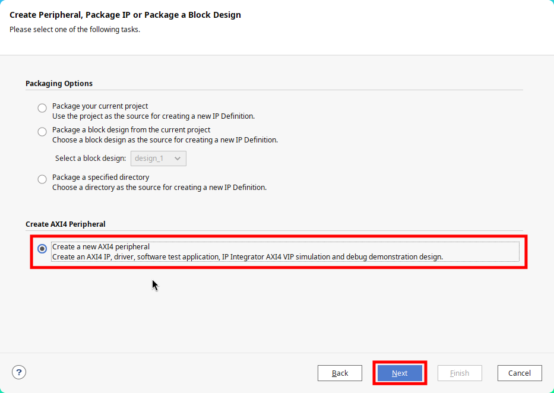

4. Enter a name such as `my_multiplier` and choose an IP location inside your lab directory, then select **Next**.

    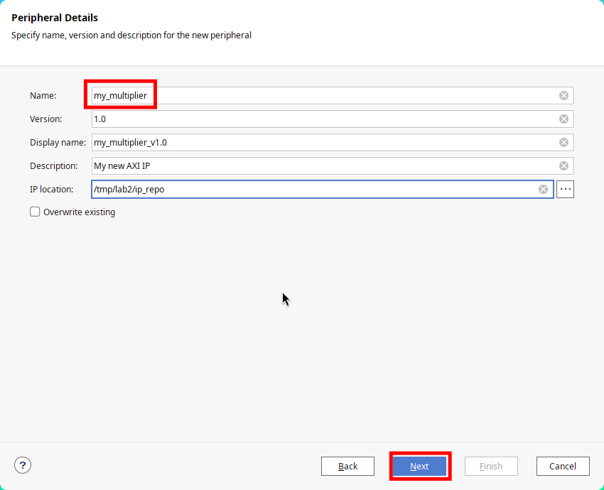

5. Configure `S00_AXI` as a **Lite**, **Slave** interface with a data width of **32 bits** and **4 registers**. The number of registers may vary depending on the application Select **Next**.

    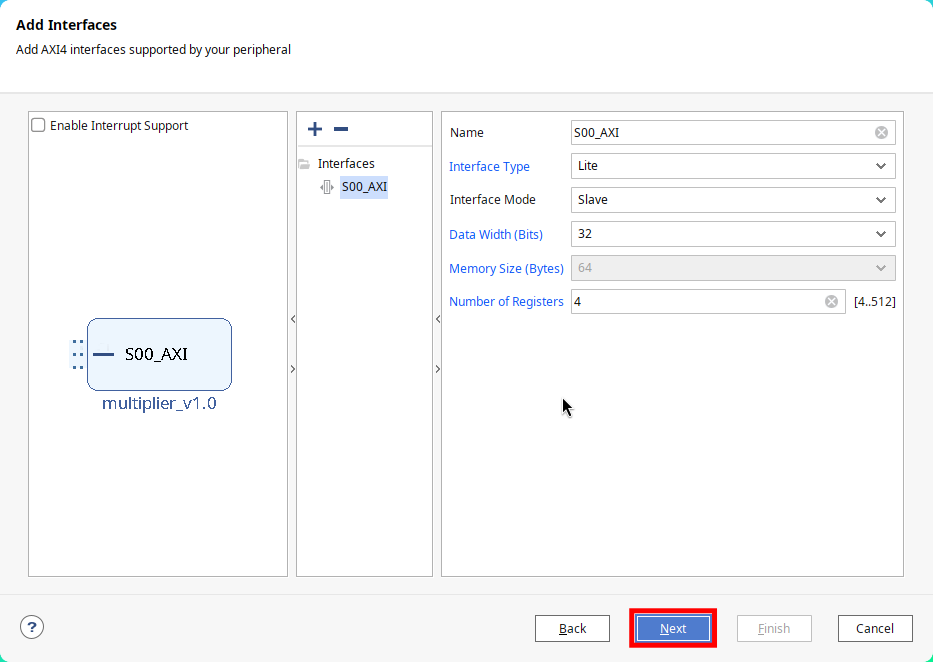

6. Select **Edit IP**, then select **Finish** to create the peripheral and open its separate IP-editing project.

    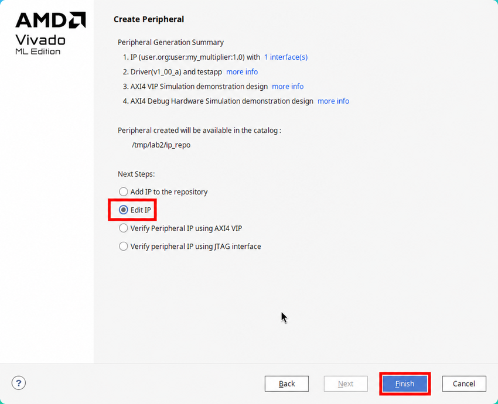

## 2. Add and connect the peripheral logic

1. In the IP-editing project, select the **Add Sources** plus sign in the **Sources** pane.

    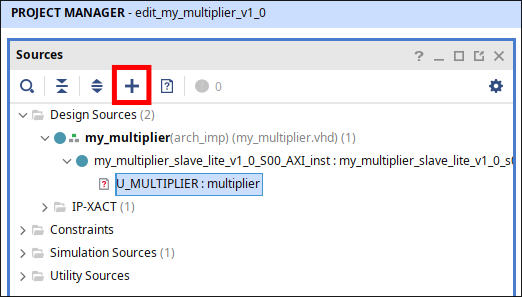

2. Select **Add or create design sources**, then select **Next**.

    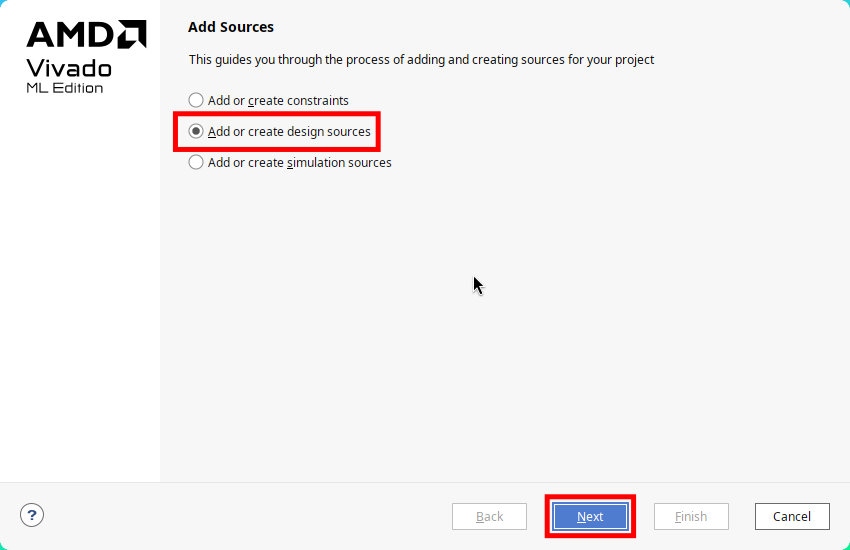

3. For this example, we'll use the multiplier entity from Lab 2. Select **Add Files** and choose `rtl/multiplier.vhd`. Clear **Copy sources into IP Directory**, then select **Finish**.

    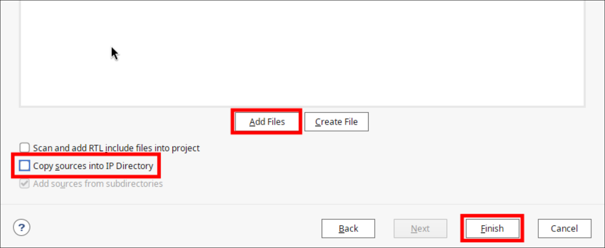

4. Edit the generated `*_S00_AXI.vhd` file to instantiate the multiplier and connect it to the required slave registers. See the Lab 2 instructions for more details on this step. Confirm that the multiplier instance appears below the AXI slave in the source hierarchy.

    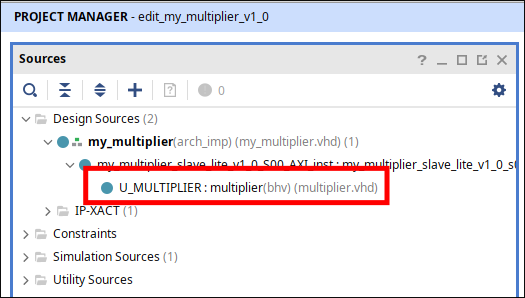

5. Open **Package IP**, select **File Groups**, and select **Merge changes from File Groups Wizard** so the added source is included in the package.

    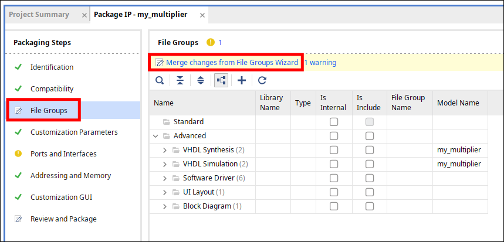

6. Select **Review and Package**, then select **Re-Package IP**.

    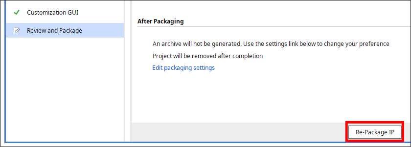

7. When packaging finishes successfully, select **Yes** to close the IP-editing project and return to the base project.

    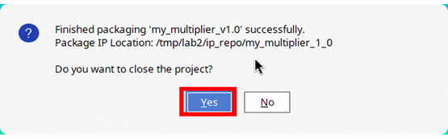

## 3. Add the peripheral to the block design

1. In `design_1`, select **Add IP**, search for the packaged peripheral, and select it to add it to the block design.

    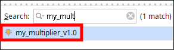

2. With the peripheral in the diagram, select **Run Connection Automation**.

    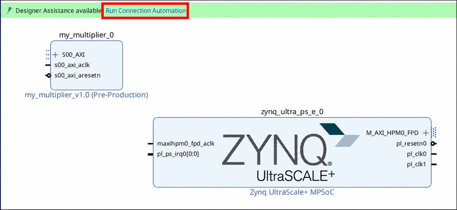

3. Choose `/zynq_ultra_ps_e_0/M_AXI_HPM0_FPD` for the master AXI connection through a new auto-generated AXI SmartConnect. Select `/zynq_ultra_ps_e_0/pl_clk0` for the bridge, slave, and master clocks, then select **OK**.

    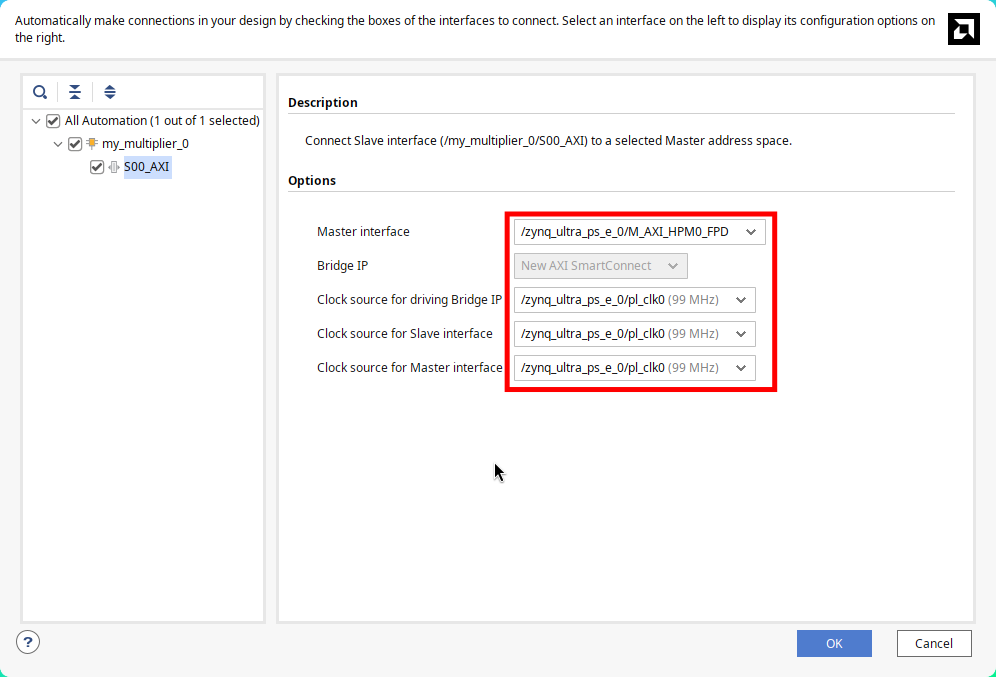

4. Confirm that SmartConnect connects `M_AXI_HPM0_FPD` to the peripheral and that the clock and reset signals are connected.

    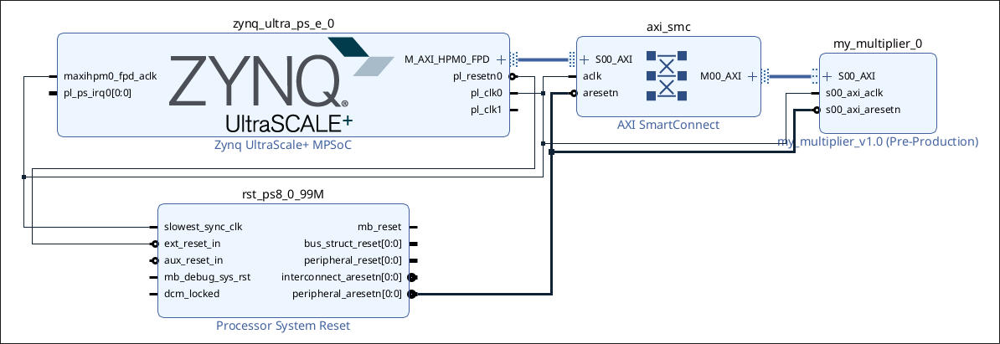

5. Open **Address Editor** and confirm that the peripheral's base address is `0xA0000000`. The default **64K** range is sufficient for this simple peripheral.

    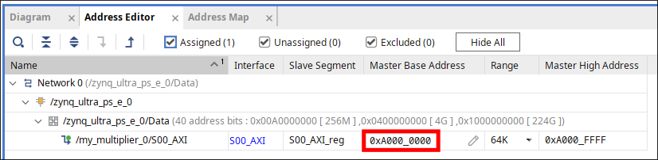

## 4. Create the wrapper and bitstream

1. In the **Sources** pane, right-click `design_1` and select **Create HDL Wrapper**.

    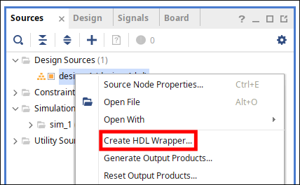

2. Select **Let Vivado manage wrapper and auto-update**, then select **OK**.

    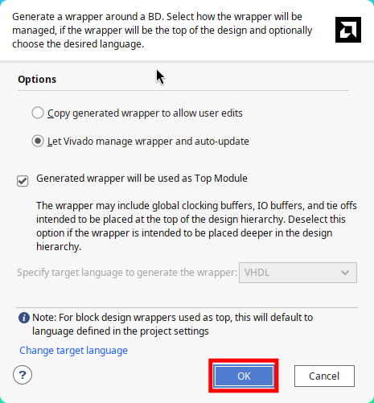

3. In the **Flow Navigator**, select **Generate Bitstream**. When generation finishes, use the `.bin` file produced by the project for the KV260 scheduler.

Refer to the [KV260 Cluster Headnode]() page for details on how to use this bitstream to submit a job to the KV260 board cluster.`

## Updating the packaged peripheral

If you need to correct the peripheral after adding it to the block design, right-click the peripheral and select **Edit in IP Packager**. Make the changes, optionally run synthesis in the IP-editing project to check for errors, then merge the file-group changes and re-package the IP as described above.

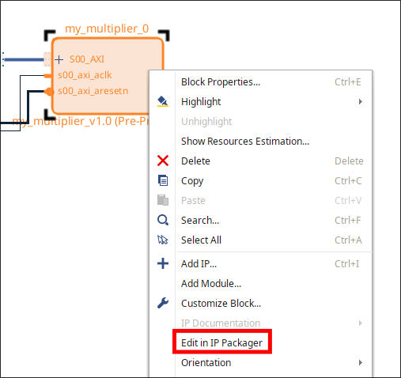

After returning to the base project, select **Report IP Status** when Vivado reports that the block should be upgraded.

Select the peripheral in the IP Status window, then select **Upgrade Selected**.

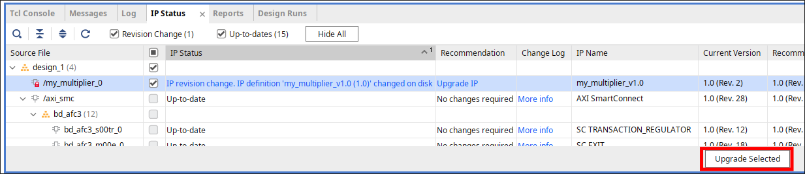

Select **Generate** to regenerate the upgraded IP's output products. When that finishes, generate the bitstream again.

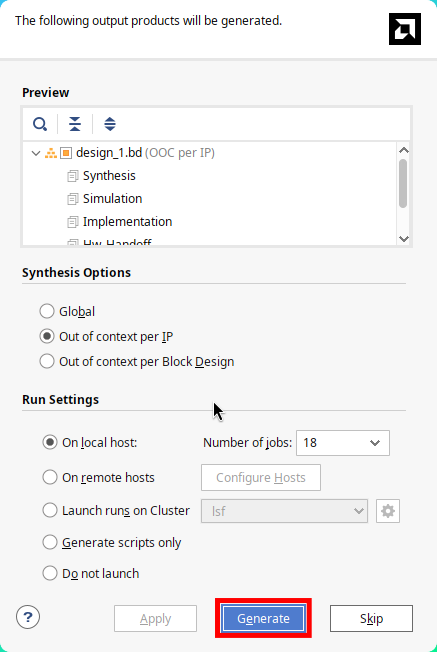
