1. Navigate to the [AMD Vivado 2025.2 downloads page](https://www.amd.com/en/support/downloads/adaptive-socs-and-fpgas/development-tools/2025-2.html).

1. Make sure to open the 2025.2.1 section/dropdown.

   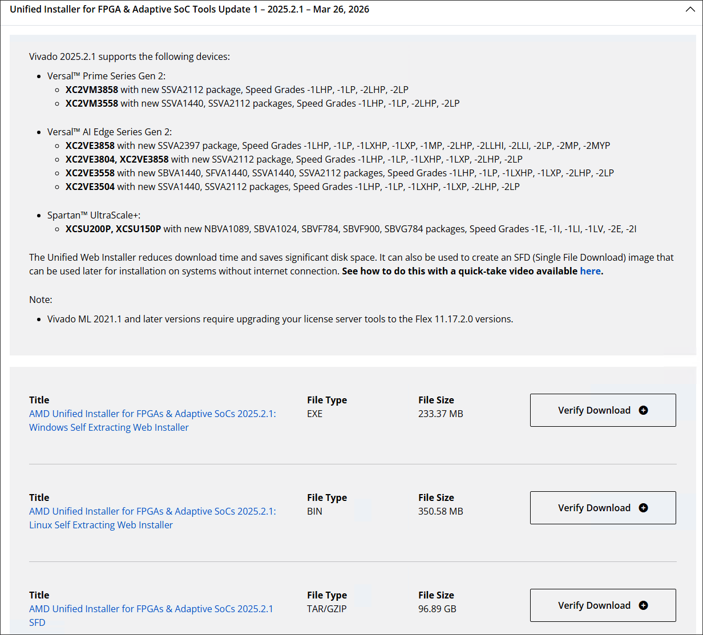

1. Download the Unified "self extracting" 2025.2.1 installer.

1. Launch the installer. It should start by extracting:

   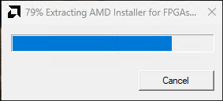

1. If prompted to download a newer version, decline it by clicking "Continue."

   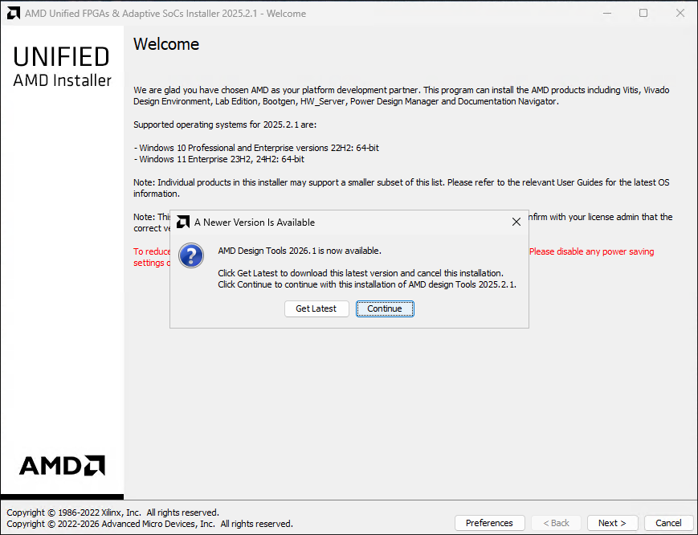

1. Click "Next."

   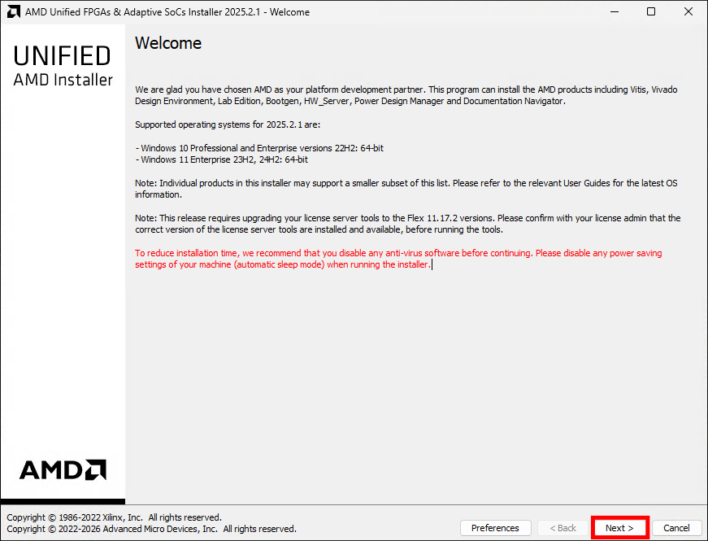

1. Enter your AMD login credentials, then click "Next."

   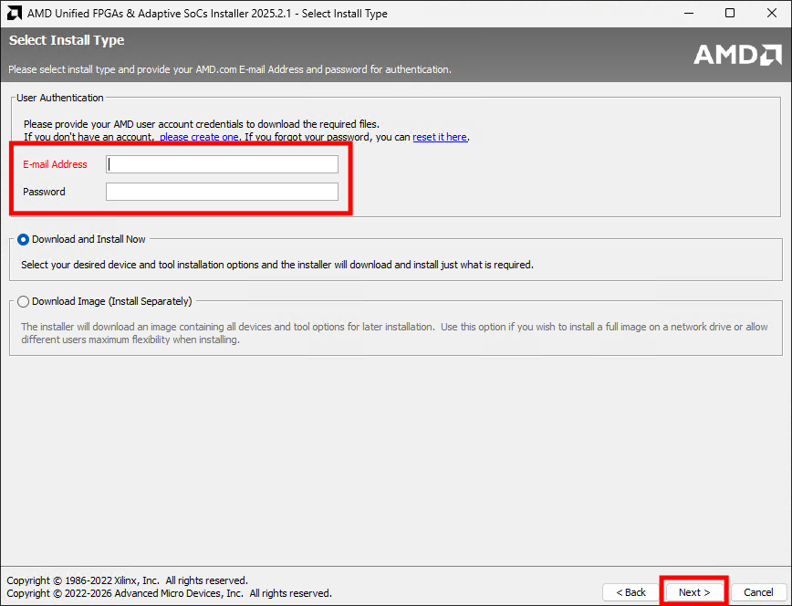

1. Select Vivado, then click "Next." If you know you want Vitis, or you may take another similar course that may use Vitis, you can select it instead. Vivado should automatically also be installed.

   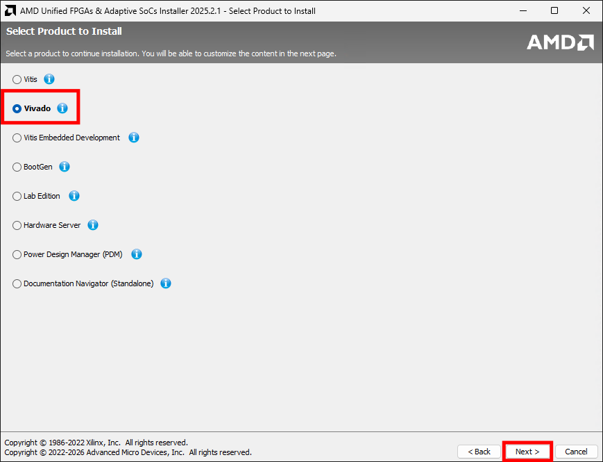

1. Select "Vivado ML Standard," then click "Next." The Kria KV260 board used for this course doesn't require a paid/licensed version of Vivado.

   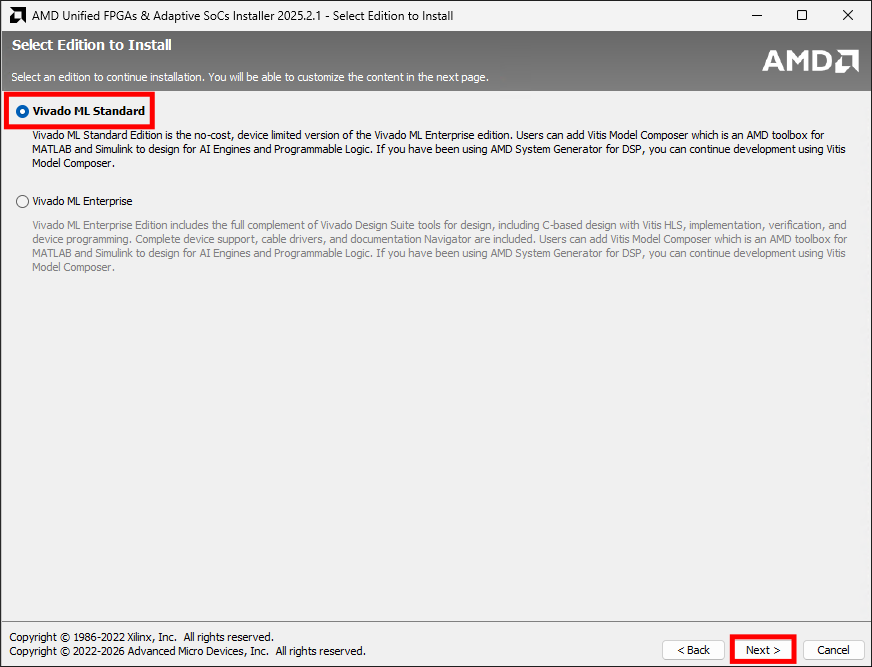

1. Select the Kria SOMs and Starter Kits and "7 Series" device options. Deselect the cable drivers and license key options at the bottom, unless you have an AMD FPGA development board that you wish to program outside of this course.

   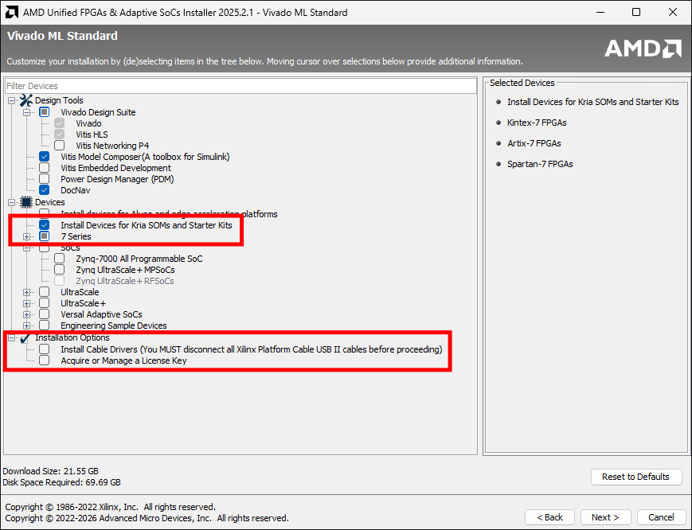

1. Agree to all of the license agreements and click "Next."

   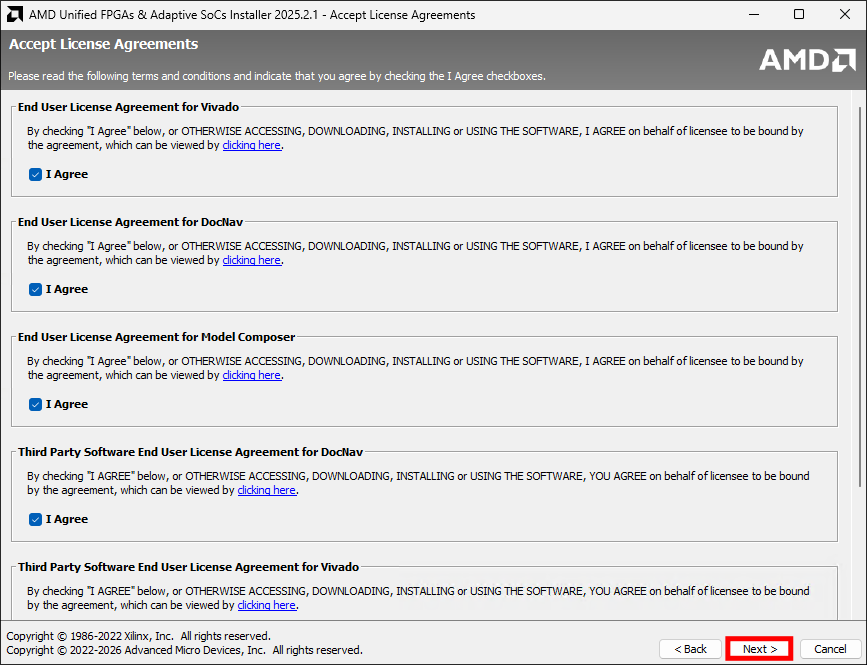

1. Confirm disk space requirements and click "Next."

   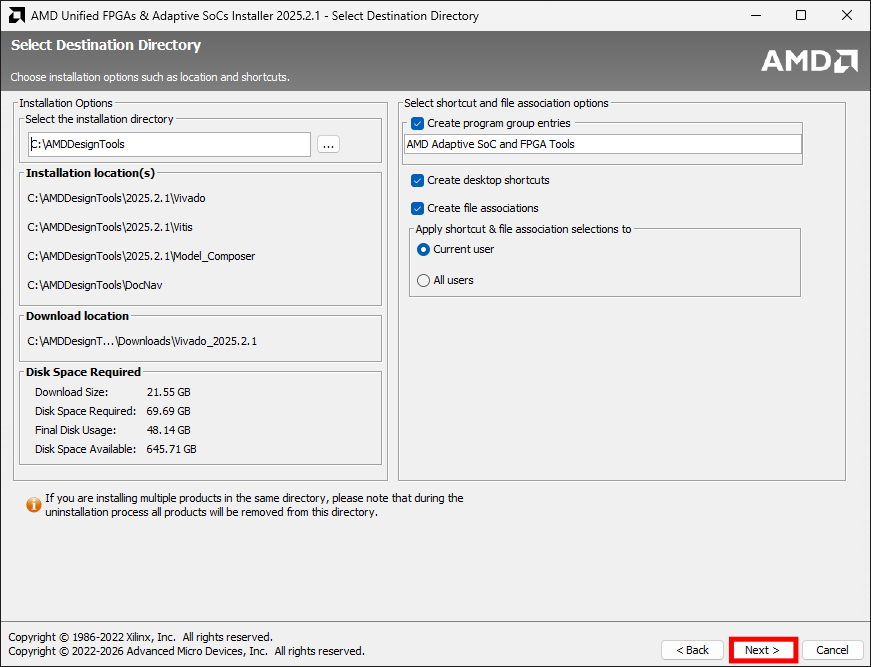

1. Click "Install."

   

1. If prompted to install any additional drivers, such as WinPcap, you can skip them.

1. Click "OK" once the installation completes.

   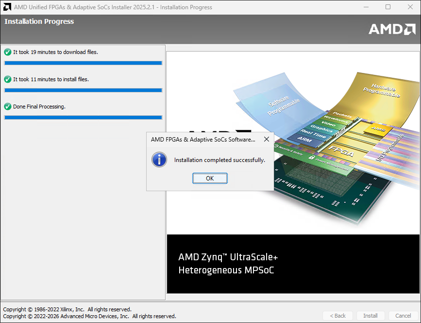
