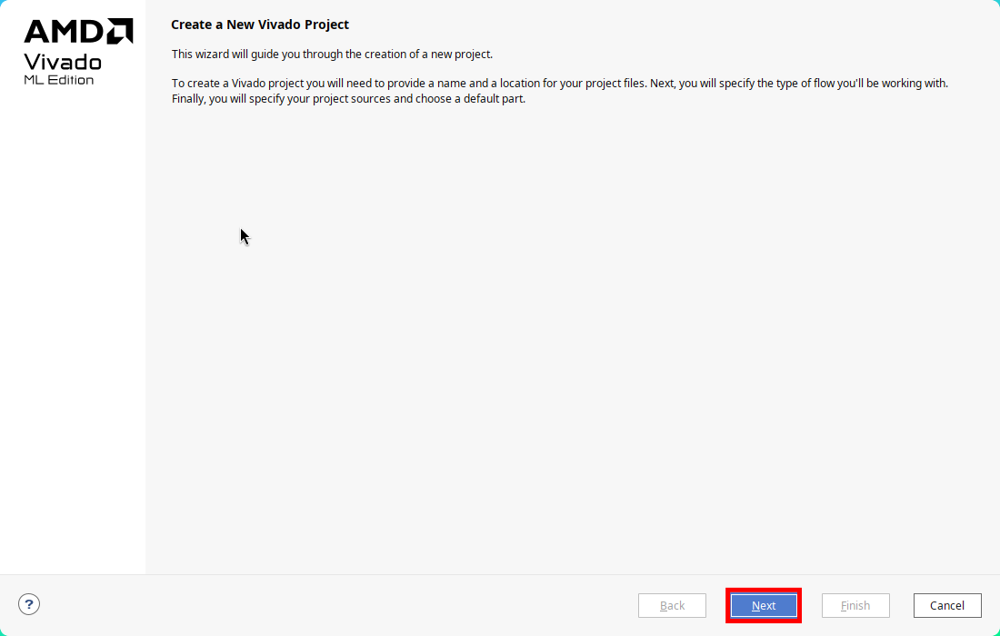
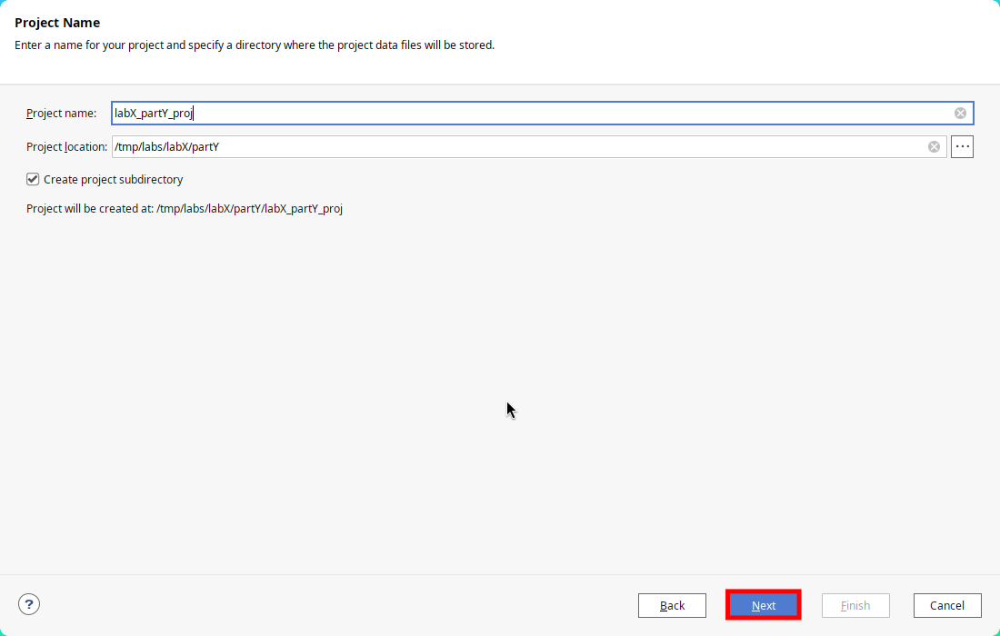
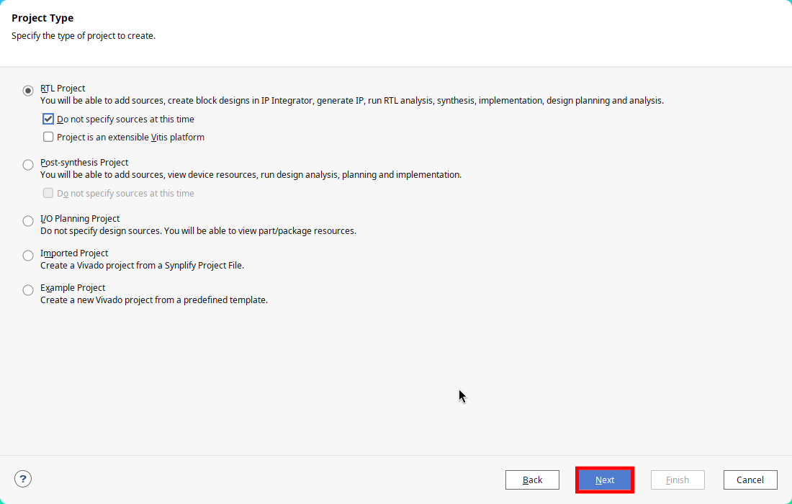
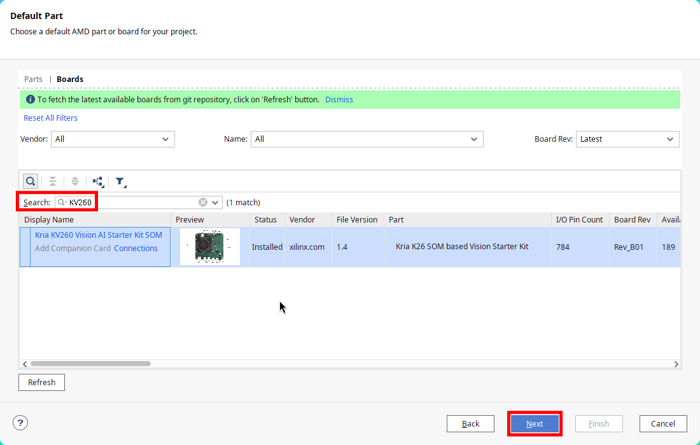
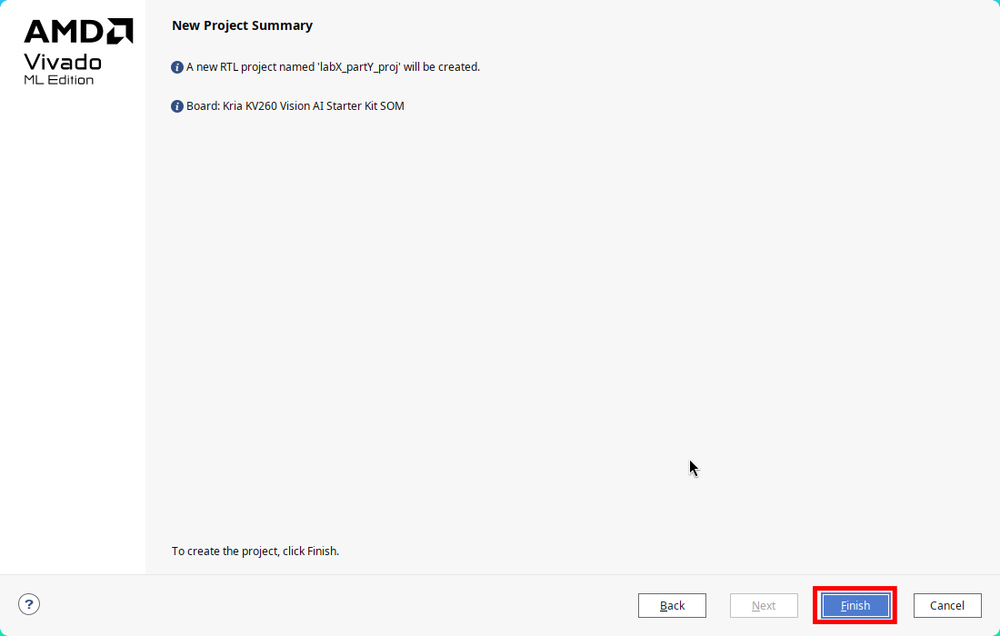
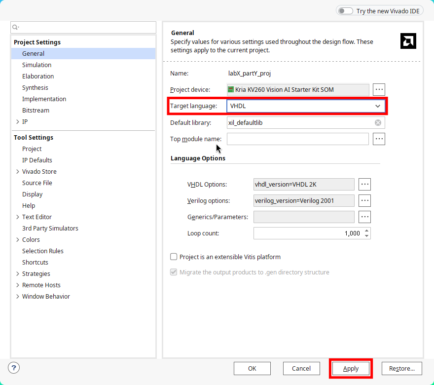
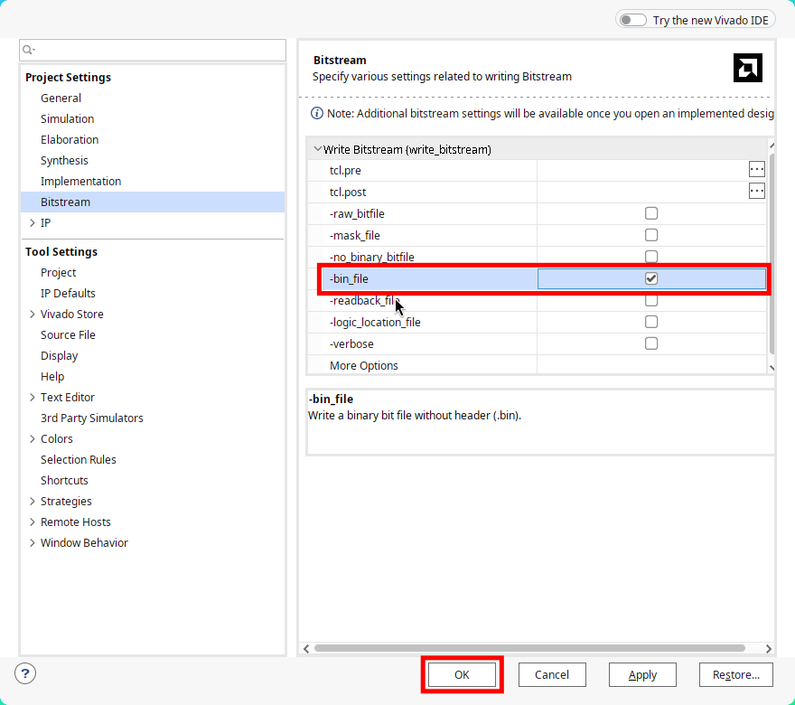
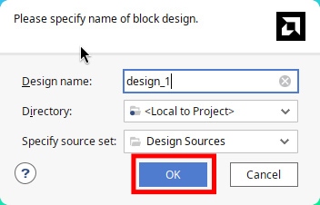
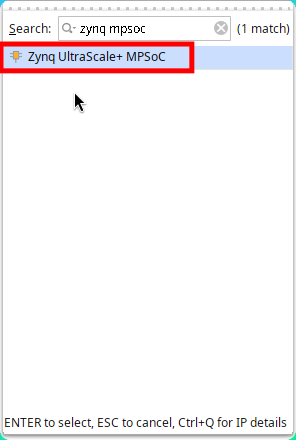
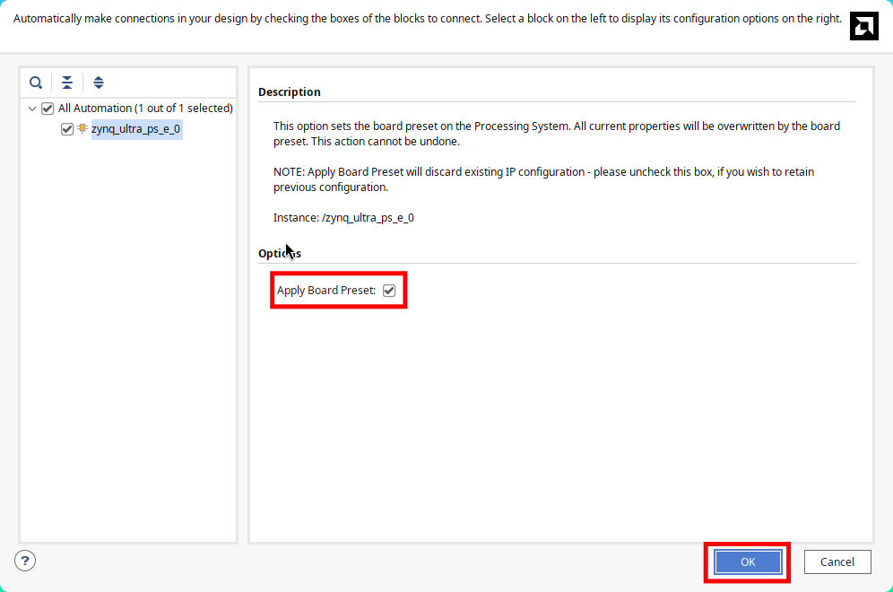

# Create a base KV260 Vivado project

These steps create the common Vivado project and block diagram used for the
course's Kria KV260 designs. They stop immediately before adding a custom AXI
slave IP.

The required version of Vivado is **2025.2.1**.

## 1. Create the project

1. Start **Vivado 2025.2.1**.
2. On the **Getting Started** page, select **Create Project**.
3. Select **Next**.

    

4. Enter a project name and select a project location.
5. Leave **Create project subdirectory** selected, then select **Next**.

    It's generally recommended to use a path without spaces or special characters.

    

6. Select **RTL Project**.
7. Select **Do not specify sources at this time**, then select **Next**.

    

8. On the **Default Part** page, select the **Boards** tab.
9. Search for `KV260`.
10. Select **Kria KV260 Vision AI Starter Kit**, then select **Next**.

    

11. On the project summary, select **Finish**.

    

## 2. Configure project settings

### Set project language as VHDL

1. In the **Flow Navigator**, under **Project Manager**, select **Settings**.
2. Select **General** in the left pane.
3. Set **Target language** to **VHDL**.
4. Select **Apply**.

    

### Enable `.bin` bitstream output type

Vivado normally generates a `.bit` bitstream file. The KV260 software stack that
configures the Programmable Logic (PL) region requires the bitstream .

1. In the **Settings** window, select **Bitstream** in the left pane.
2. Enable **-bin_file** option.
3. Select **OK**.

    > **Important**: Vivado may generate both `.bit` and `.bin` files when the completed design's
bitstream is generated. You will have to submit the `.bin` file to the course's KV260 scheduler;
`.bit` files will NOT work.

    

## 3. Create the block design

1. In the **Flow Navigator**, expand **IP Integrator**.
2. Select **Create Block Design**.
3. Keep the default design name, `design_1`, and select **OK**.

    

4. In the block-design toolbar, select **Add IP**.
5. Search for `Zynq UltraScale+ MPSoC`.
6. Double-click **Zynq UltraScale+ MPSoC** to add it to the diagram.

    

7. Select **Run Block Automation**.
8. Leave **Apply Board Preset** selected and accept any remaining defaults.
9. Select **OK**.

    

The board preset configures the processing system for the KV260 hardware.

## Base project complete

At this point, the base project is complete. The next design-specific step is to add the
lab's AXI slave IP to the `design_1` block design. Connection automation, address assignment,
block-design validation, HDL-wrapper creation, and bitstream generation happen
after that slave IP has been added.

Instructions for adding AXI slave IP in the form of custom accelerators will be
provided starting with Lab 2.
