# Vivado Quickstart: Generating a Bitstream for the Kria KV260

This tutorial provides a short introduction to the **AMD Vivado Design
Suite** using the **AMD Kria KV260 Vision AI Starter Kit**.

The objective is to verify that your VHDL design can be successfully
synthesized and implemented and that Vivado can generate the FPGA
**bitstream (`.bit`) file** .

You will **not program the FPGA board in this tutorial**. The course
boards are connected to a server and instructions for programming them 
will be provided in Lab 2. The purpose of this tutorial is to enable you 
to check for errors using the synthesis tool.

The basic design flow is:

``` text
Create Vivado Project
        ↓
Add VHDL Design Files
        ↓
Add XDC Constraints
        ↓
Run Synthesis
        ↓
Run Implementation
        ↓
Generate Bitstream
```

## 1. Start Vivado [You should be using 2025.2.1]

Launch **Vivado**.

On Linux, if Vivado has been added to your environment, you can start it
from a terminal with:

``` bash
vivado &
```

The Vivado **Getting Started** screen should appear.


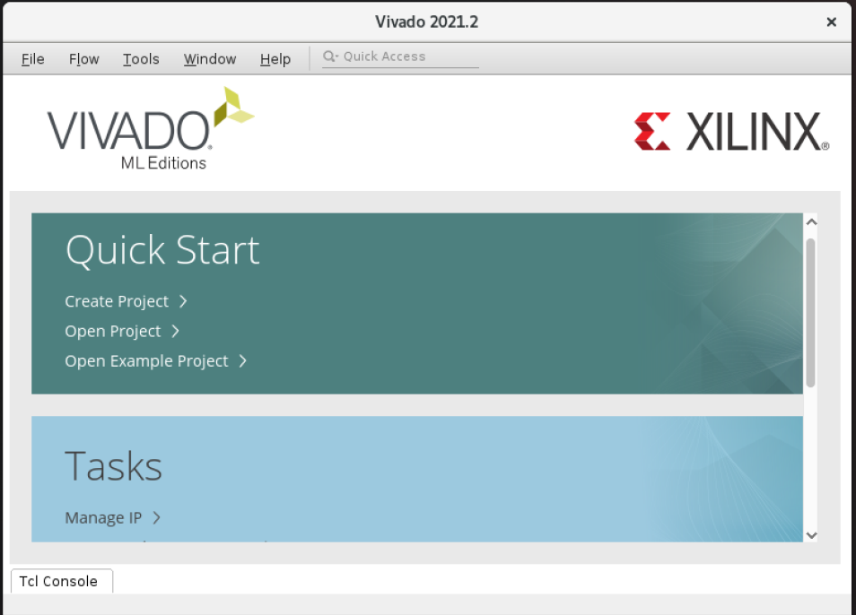

## 2. Create a New Project

From the Getting Started screen, click:

**Create Project**

Alternatively, select:

**File → Project → New**

The **New Project** wizard will open.

1.  Click **Next**.
2.  Enter a project name, for example:

    ``` text
    Demo
    ```

3.  Select a location for the project.
4.  Keep **Create project subdirectory** selected.
5.  Click **Next**.

> **Recommendation:** Avoid spaces and special characters in project and
> directory names.


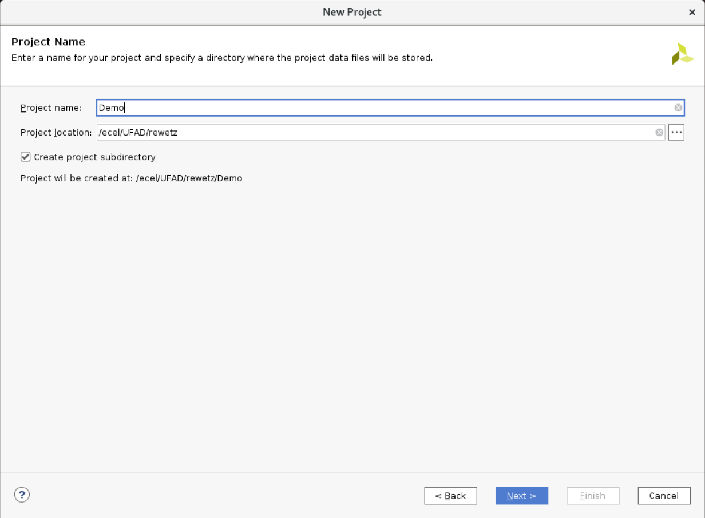

## 3. Select the Project Type

Select:

**RTL Project**

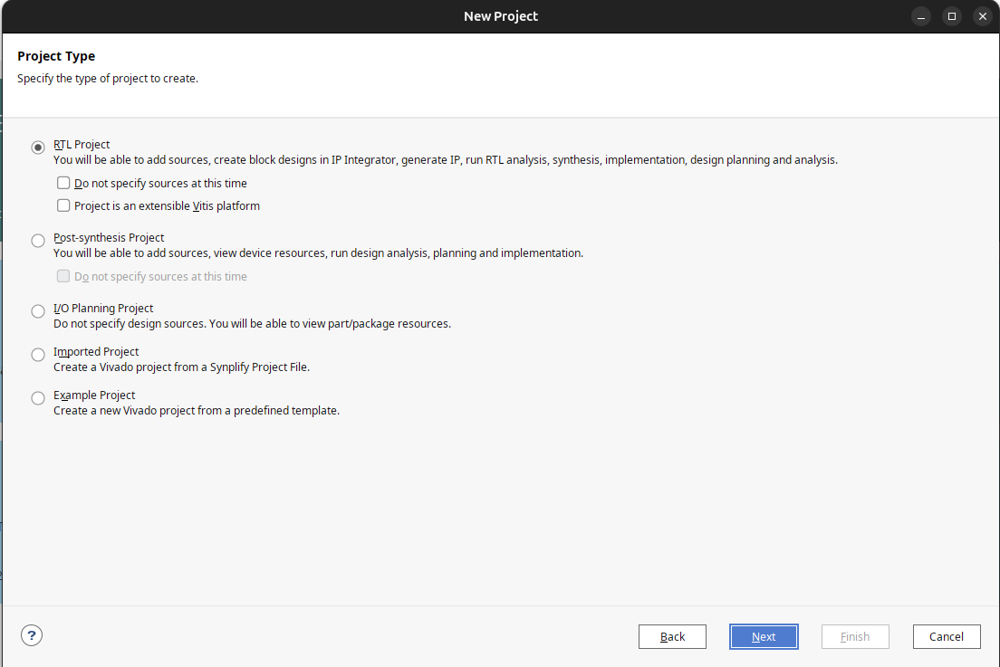

Click **Next**.

For this tutorial, select:

**Do not specify sources at this time**

Click **Next**.

**Do not specify constraints at this time**

Click **Next**.


## 4. Select the Kria KV260 Board

On the **Default Part** page:

1.  Select the **Boards** tab.
2.  Search for:

    ``` text
    KV260
    ```

3.  Select the **Kria KV260 Vision AI Starter Kit**.
4.  Click **Next**.

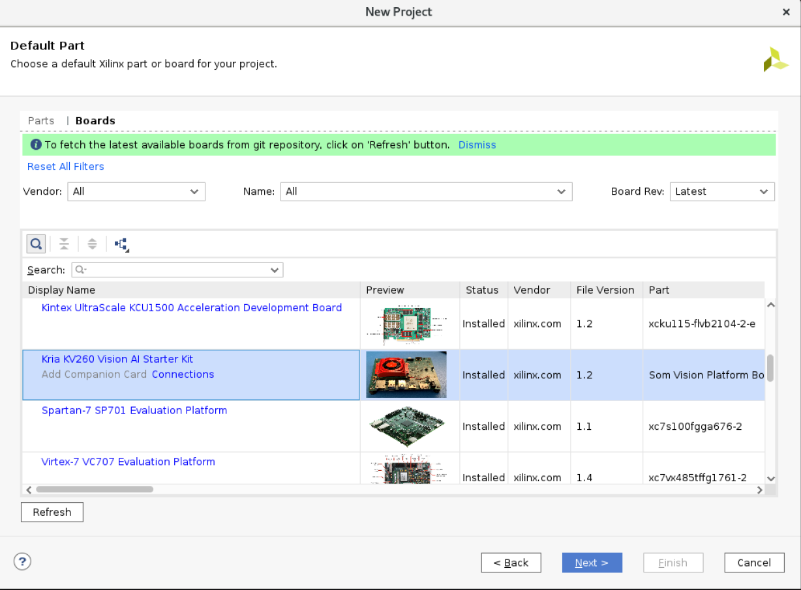

Review the project summary and verify that the KV260 is the selected
target board.

Click **Finish**.

Vivado will create the project and open the **Project Manager**.

## 5. Add the VHDL Design Files

In the **Flow Navigator**, under **Project Manager**, click:

**Add Sources**

Select:

**Add or create design sources**

and click **Next**.

Click **Add Files** and select the VHDL files required for the design.

For this example, download the shared [`SimpleLogic.vhd`]() and [`top_level.vhd`]() files, save them in your project directory, and add them to the project.

Click **Finish**.

The files should now appear in the **Sources** window.


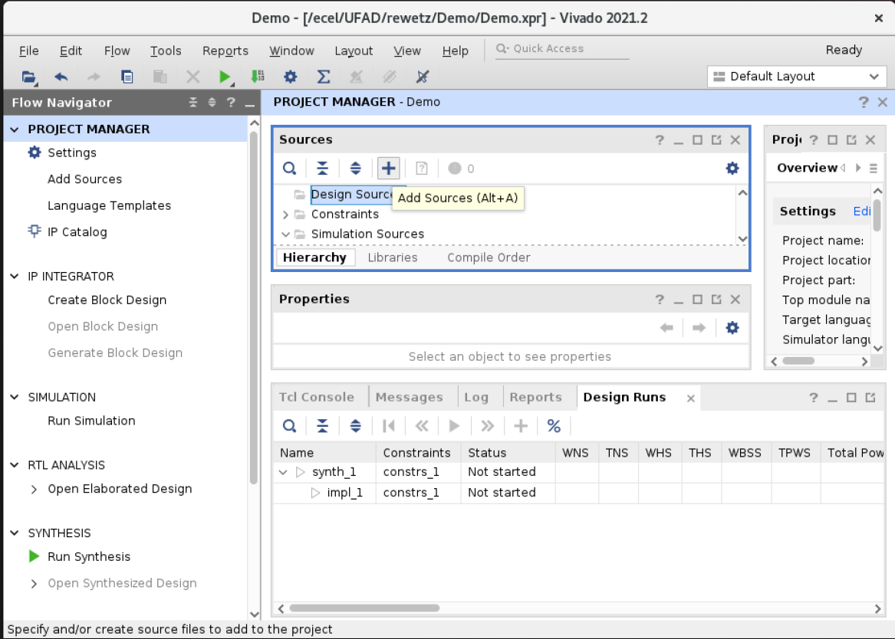

## 6. Set the Top-Level Entity

Vivado must know which VHDL entity represents the top level of the FPGA
design. (If you only have one file, Vivado may infer this step automatically.)

In the **Sources** window:

1.  Locate the intended top-level entity.
2.  Right-click the entity.
3.  Select **Set as Top**.

For example:

``` text
top_level
```

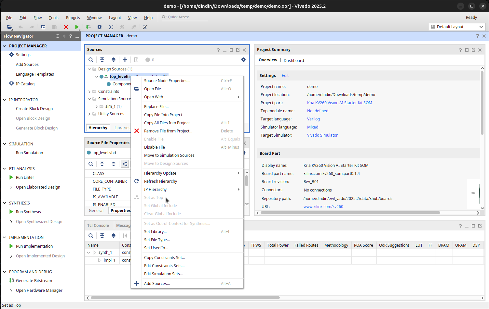


> **Important:** Make sure that the correct entity is selected as the
> top level before running synthesis.

## 7. Add the XDC Constraint File [You don't need this for the first couple of labs]

Vivado uses an **XDC (Xilinx Design Constraints)** file to specify
design constraints, including physical pin assignments, I/O standards,
and timing constraints.

For the course labs, the required XDC file will normally be provided.

To add the constraint file:

1.  Click **Add Sources**.
2.  Select **Add or create constraints**.
3.  Click **Next**.
4.  Click **Add Files**.
5.  Select the provided `.xdc` file.
6.  Click **Finish**.

For example:

``` text
top_level.xdc
```

The XDC file should now appear under **Constraints** in the Sources
window.

```{=html}
<!-- Insert image showing the XDC file under Constraints. -->
```

## 8. Run Synthesis

In the **Flow Navigator**, under **Synthesis**, click:

**Run Synthesis**

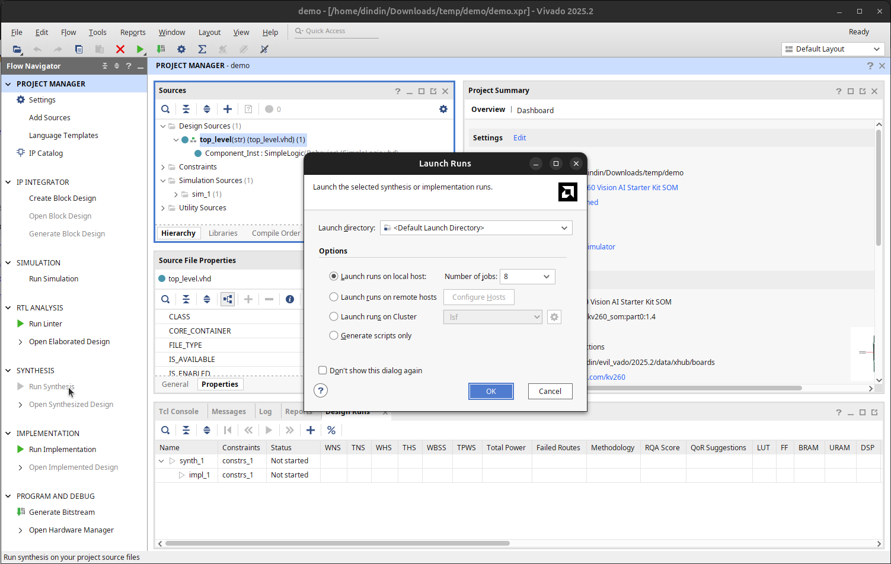

Vivado will synthesize the VHDL design into FPGA hardware resources.

When synthesis completes, verify that there are **no errors**.

If synthesis fails:

1.  Check the **Messages** window.
2.  Locate the reported errors.
3.  Correct the VHDL source or constraints.
4.  Run synthesis again.

> **Do not continue to implementation until synthesis completes
> successfully.**

Warnings should also be reviewed. Some warnings may be harmless, while
others may indicate problems with the design.

## 9. Run Implementation

After synthesis completes successfully, run implementation.

In the **Flow Navigator**, under **Implementation**, click:

**Run Implementation**

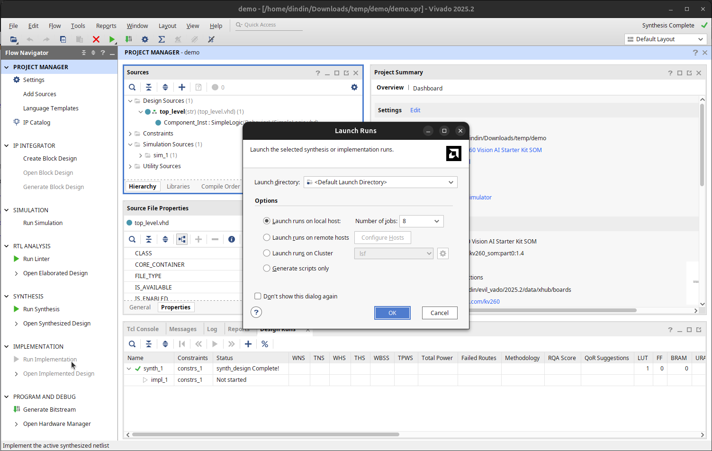

Vivado will map the synthesized design onto the target FPGA and perform
placement and routing.

When implementation completes, verify that there are **no errors**.

If implementation fails, inspect the **Messages** window and correct the
reported problems before continuing.

## 10. Generate the Bitstream

After implementation completes successfully, click:

**Generate Bitstream**

under **Program and Debug** in the Flow Navigator.

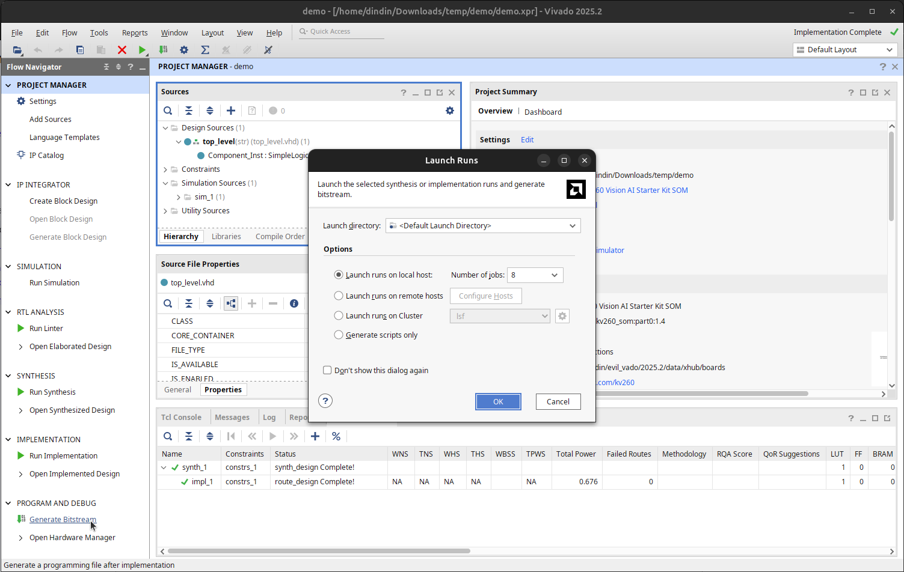

Vivado will generate the FPGA programming file.

Wait until Vivado reports that **bitstream generation completed
successfully**.

**WARNING:** Generating a bitstream for `SimpleLogic.vhd` will result in an error because the FPGA input/output pins have not yet been assigned to the circuit's input/output signals.

At this point, the design has successfully passed the Vivado flow:

``` text
VHDL
  ↓
Synthesis
  ↓
Implementation
  ↓
Bitstream Generation
  ↓
.bit file
```

## 11. Locate the `.bit` File

The generated `.bit` file is normally located inside the Vivado project
directory under the implementation run directory:

``` text
<project_name>.runs/impl_1/
```

For example, if the top-level entity is named `top_level`, the generated
file will typically be:

``` text
<project_name>.runs/impl_1/top_level.bit
```

Verify that the `.bit` file was generated.

> **This is the final step of this tutorial.** You do not need to
> program the KV260 locally. The course FPGA boards are connected to a
> server and will be programmed separately.

## Recommended Workflow

For the course labs, use **QuestaSim first** for functional verification
and then use Vivado to verify that the design can be implemented on the
FPGA.

``` text
Write/Edit VHDL
      ↓
Compile in QuestaSim
      ↓
Functional Simulation
      ↓
Debug until correct
      ↓
Open/Add Design in Vivado
      ↓
Run Synthesis
      ↓
Run Implementation
      ↓
Generate Bitstream
      ↓
Verify .bit File
```

### QuestaSim vs. Vivado

**QuestaSim** is primarily used to:

-   Compile VHDL quickly
-   Run functional simulations
-   Inspect waveforms
-   Debug logical behavior

**Vivado** is used to:

-   Synthesize the VHDL into FPGA hardware
-   Map the design onto the KV260 FPGA resources
-   Perform placement and routing
-   Check implementation constraints
-   Generate the final `.bit` file

A design that simulates correctly in QuestaSim is not necessarily
synthesizable or implementable on the FPGA. Therefore, successful
**bitstream generation in Vivado** provides the final implementation
check before the design is used on the course FPGA server.
run implementation

## how to view schematic

You can view a schematic of your design:

Tools > schematic

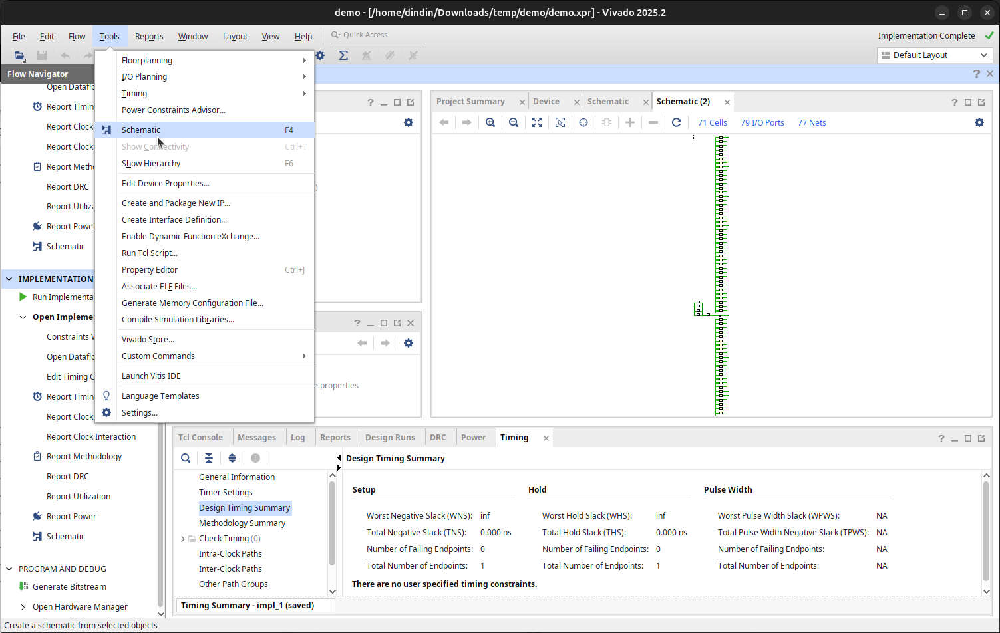

```
You can't view the schematic until you have run implementation.
```

## how to view resource usage

You can view the resource utilization of your design:

open synthesized/implemented design -> Report Ultilization -> ok

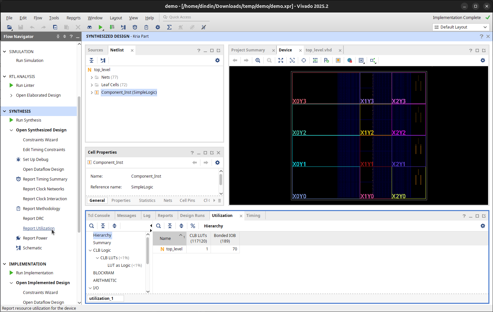

```
There are utilization reports for synthesized and implementation.

Post-synthesis report: based on generated netlist.

Post-implementation report: literally what got placed and routed. If vivado optimizes something into or out of your design, it will be reflected here.
```